# Digital Garden Wessel de Wit

Dit is mijn digitale tuintje voor het vak Het web is voor iedereen. Op deze site laat ik twee kanten van mezelf zien: mijn sportieve kant en mijn creatieve kant.

## Sprints

### Sprint 0 - Getting a grip

#### Ma: Kickoff

1. Leg uit wat een source hosting platform is en voor welke jij gekozen hebt.

Antwoord: Een source hosting platform is een tool waarin je je code kan maken en opslaan. Wat ik nu daarvoor gebruik, is GitHub.

2. Vertel welke domeinnaam jij gekozen hebt en hoe je die hebt gekoppeld aan jouw pagina.

Antwoord: Ik heb als domeinnaam [wesseldewit.nl](http://wesseldewit.nl) gekocht bij TransIP en die heb ik door middel van github live gekregen.

3. Beschrijf hoe je aanpassingen aan jouw pagina kunt maken en hoe je er voor zorgt dat die op het web gepubliceerd worden.

Antwoord: Wanneer ik op mijn vscode een wijziging maak kan ik het daarna via de github desktop pushen naar mijn live website.

### Sprint 1 - Digital Garden

#### Ma: Sprintplanning + WS 1

1. Leg uit wat een digital garden is en waarom dat anders is dan een reguliere website.

Antwoord: Je digital garden is een website die je maakt naar eigen zin. Je kiest een onderwerp en een style dat bij je past als persoon. Uiteindelijk wordt deze site een soort identiteit/portfolio van jezelf.

2. Leg uit wat een website 'webby' maakt en welke websites jou het meeste inspireren.

Antwoord: Ik heb eigenlijk geen websites die mij inspireren.

3. Vertel waar jij mee aan de slag wilt gaan bij het maken van jouw eigen digital garden (let op: dit zijn jouw eerste ideeën, dit kan en mag veranderen in de loop van het programma).

Antwoord: Als onderwerp kies ik iets wat dicht bij mij staat, dingen waar ik veel mee bezig ben zoals sporten en gezond leven.

##### Rangschikken

Site 1: https://www.adidas.nl/
Fluide/adaptief: Ja
Interactief/dynamisch: wanneer je ergens overheen hovert, zie je dat je erop kunt klikken, maar voor de rest gebeurt er niet zoveel.
Toegankelijk: je ziet een groot verschil tussen de producten en als je erop hovert, zie je ook goed dat er een lijntje omheen komt, zodat je erop kunt klikken.
Volwassen: het ziet er zeer professioneel uit. Professionele foto's, verschillende variaties op foto's, maar die wel allemaal bij elkaar passen.
Expressief: het ziet er vrij statisch uit. Er zijn simpele lettertypes gebruikt. Simpele kleuren, zoals wit en zwart.
Leuk/verrassend: niks verassend. Geen animaties gebruikt alleen profesionele foto's van hun producten. 

Site 2: https://www.upfront.nl/
Fluide/adaptief: Ja
Interactief/dynamisch: wanneer je hovert op een product, gebeurt er iets. Dan zie je de macro’s ervan, of je ziet het product een draai van 360 graden maken.
Toegankelijk: Er is veel contrast in de kleuren, dus voor mensen met slecht zicht is het zeker toegankelijk. 
Volwassen:wanneer je eroverheen hovert, zie je dat het de knop is, omdat je op het plusje kunt drukken dat dan in beeld verschijnt. Het werkt ook goed op mobiel.
Expressief: het ziet er heel simplistisch uit. Eigenlijk is alles in het wit, waardoor de aandacht naar de producten zelf gaat.
Leuk/verrassend: ik vond het effect waarbij de producten een draai van 360 graden maken leuk.

Meest webby en waarom: ik denk dat ik die van het upfront het meest webby vind, omdat daar meer gebeurt dan op de site van Adidas.

#### Wo: WS 2

1. Leg uit waar het Visual Research in 3 stappen naartoe werkt.

Antwoord: Luisteren naar de doelgroep, daarvoor ontwerpen en dat dan delen.

2. Vertel in 2 zinnen waar jouw Garden over gaat, en met welke content je dat gaat doen (beeld, tekst, sound, animatie enz.).

Antwoord: Mijn garden wordt een trap met allerlei woorden. Al die woorden bij elkaar maken mij tot wie ik ben.

3. Vertel kort welk idee van de Crazy 8 je het liefst zou willen uitvoeren/verder zou willen onderzoeken.

Antwoord: Ik wil dat de focus gaat naar één punt. (mijn naam)

In de les moesten we een onderwerp verzinnen voor onze digital garden en in Miro daar allemaal afbeeldingen bij zoeken. Mijn onderwerp dat ik had gekozen was discipline. Dit heb ik gekozen omdat ik vind dat dit goed bij mij past. In mijn leven sport ik veel en probeer ik zo gezond en gebalanceerd mogelijk te leven. Hierbij is discipline cruciaal. In eerste instantie zochten we naar afbeeldingen die erbij pasten en daarna moesten we een abstracte versie daarvan vinden. Daarbij moesten we allerlei sfeerwoorden bedenken die pasten bij het onderwerp. Wat mij opviel, zoals te zien is in de afbeelding, is dat focus, op een letterlijke en figuurlijke manier, veel te zien was in de afbeeldingen die ik had gevonden.

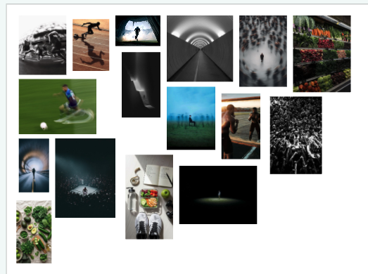
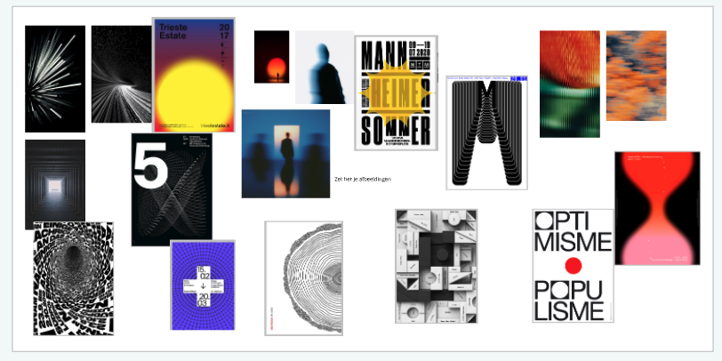

Dit heb ik meegenomen in mijn schetsen en ben eerst begonnen met het maken van een paar Crazy 8's. Daar heb ik allerlei verschillende schermen gemaakt waarbij de focus uiteindelijk gaat naar een specifiek punt.

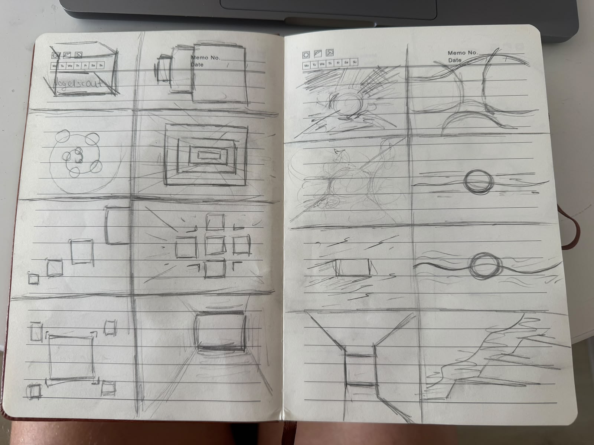
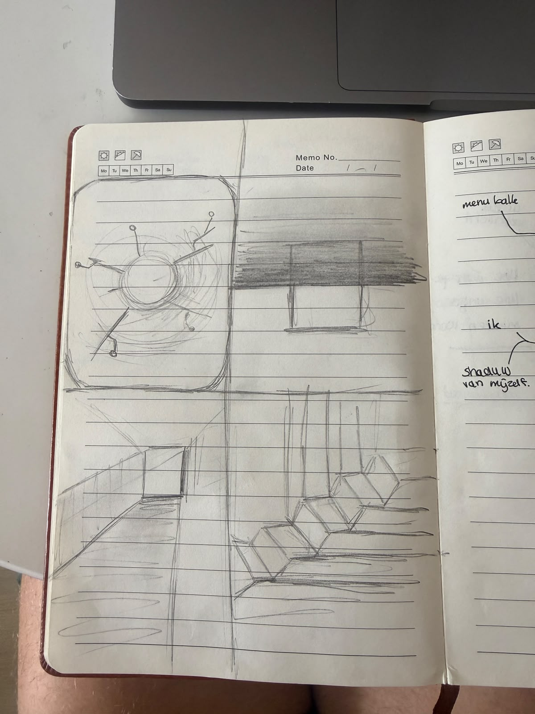

#### Vr: WS 3 + Voortgang

1. Welke feedback heb je gehad?

Antwoord: De eerste vrijdag bij de feedback had ik online feedback gekregen van Justus. Hij vertelde dat de manier van coderen niet leesbaar was. De reden daarvoor was dat ik het vorig jaar zo had geleerd, maar in DLO staat dat het op een andere manier moet. Toen ben ik opnieuw begonnen en heb ik het op de juiste manier gecodeerd.

Nadat ik wat ideeën had opgedaan, ben ik wireframes gaan schetsen met annotaties ter verduidelijking. De annotaties zette ik voorheen niet bij mijn schetsen, maar na de deep dive zie ik zeker in dat dit een toevoeging is, helemaal als je het in verschillende kleuren doet.

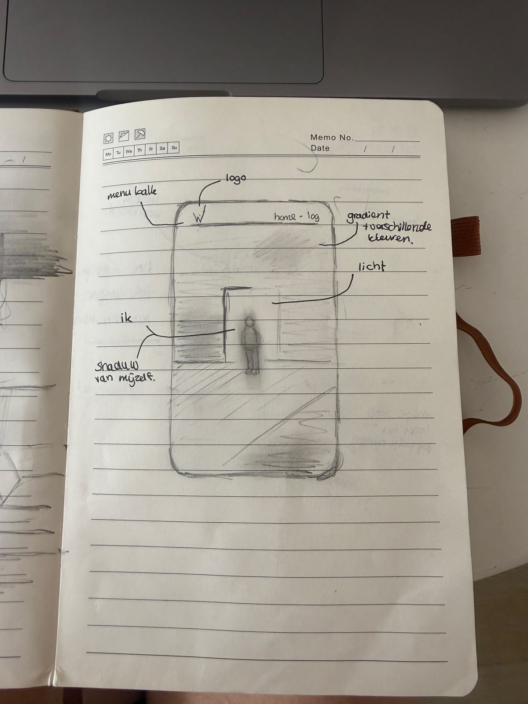
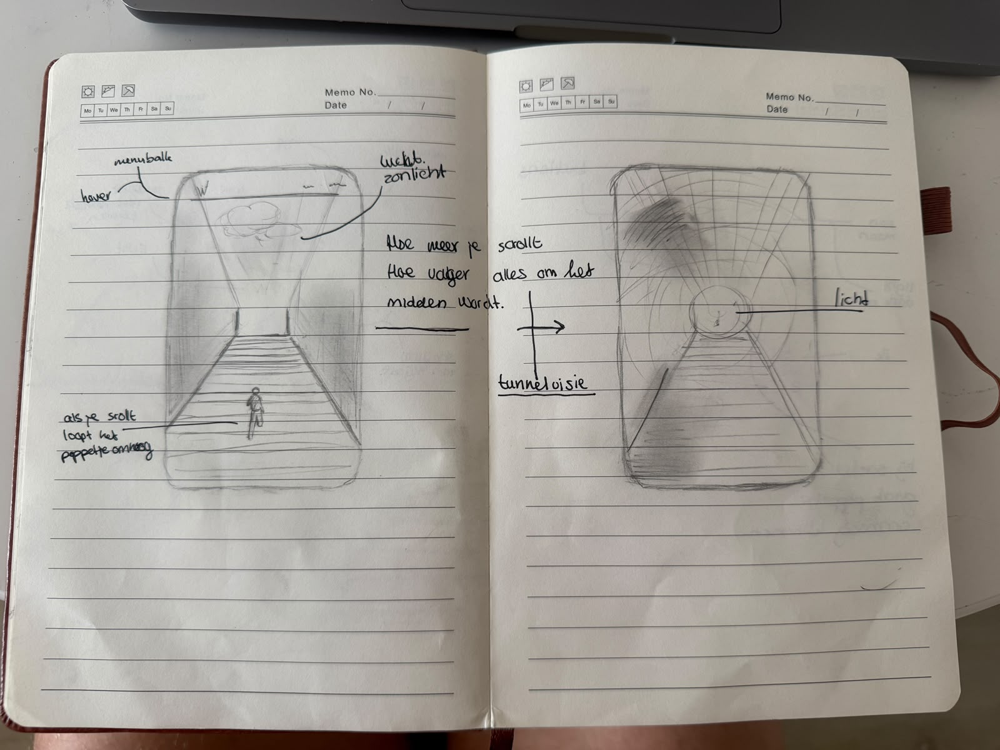

Na een aantal schetsen gemaakt te hebben, kwam ik er uiteindelijk op uit om een poppetje (ik) een berg te laten beklimmen met bepaalde punten die dan buttons moesten voorstellen. Daarop zou je dan kunnen drukken en zou er informatie te zien zijn. Dit was een leuk idee, maar er zat zeker nog verbetering in. Toen kwam ik op het fantastische idee om de trap te maken uit woorden die in mijn leven zeer van belang zijn, waarbij uiteindelijk aan het einde van de trap mijn volledige naam te lezen is. Nadat ik dit idee in zijn volledigheid op papier had, ben ik gaan coderen.

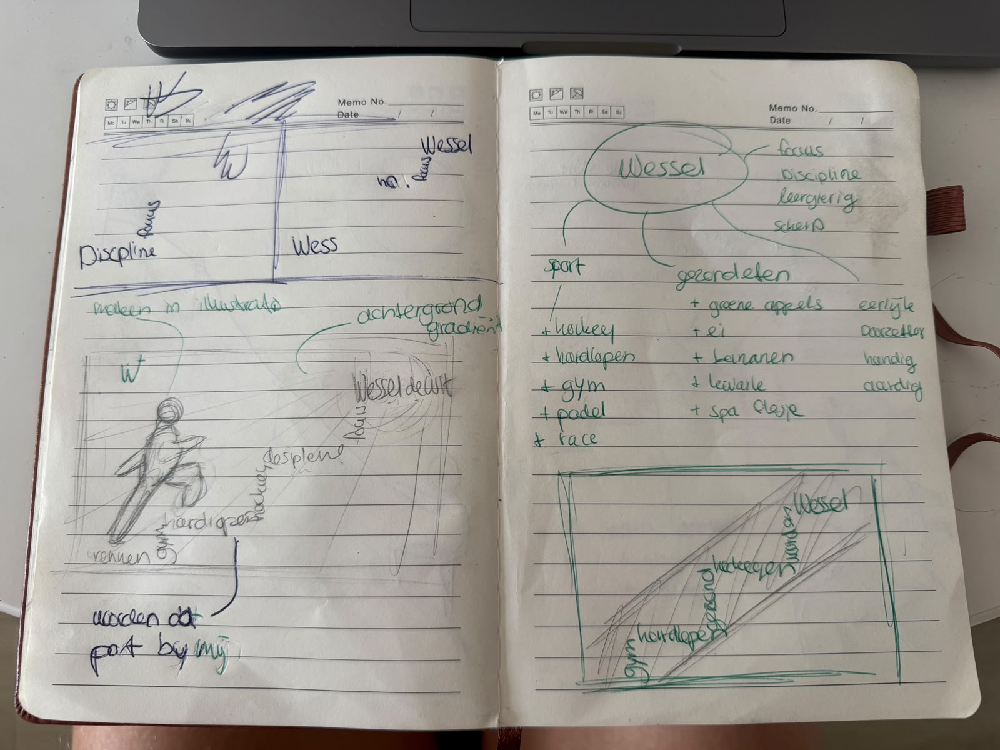
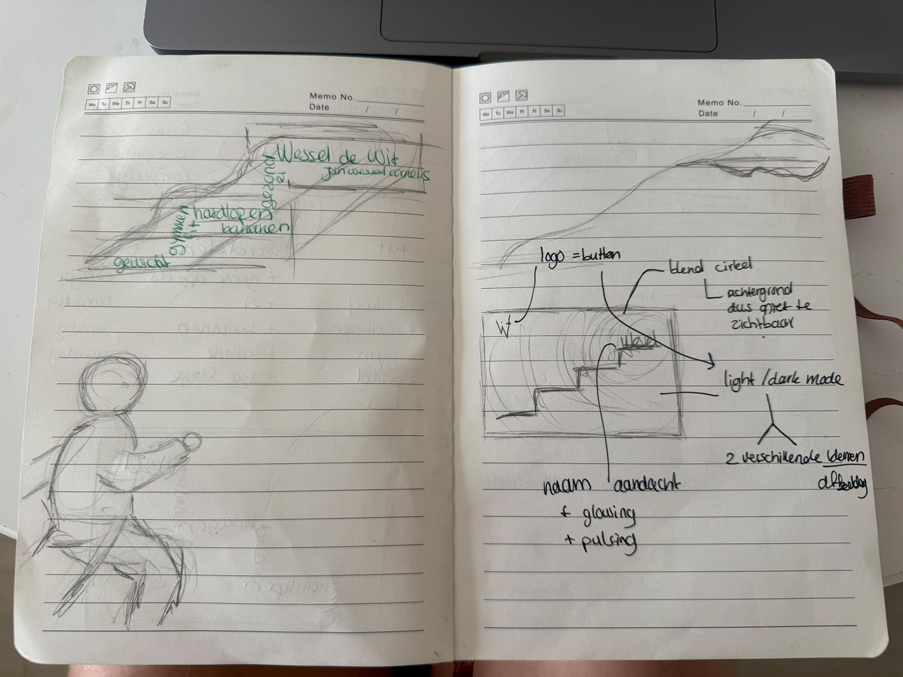
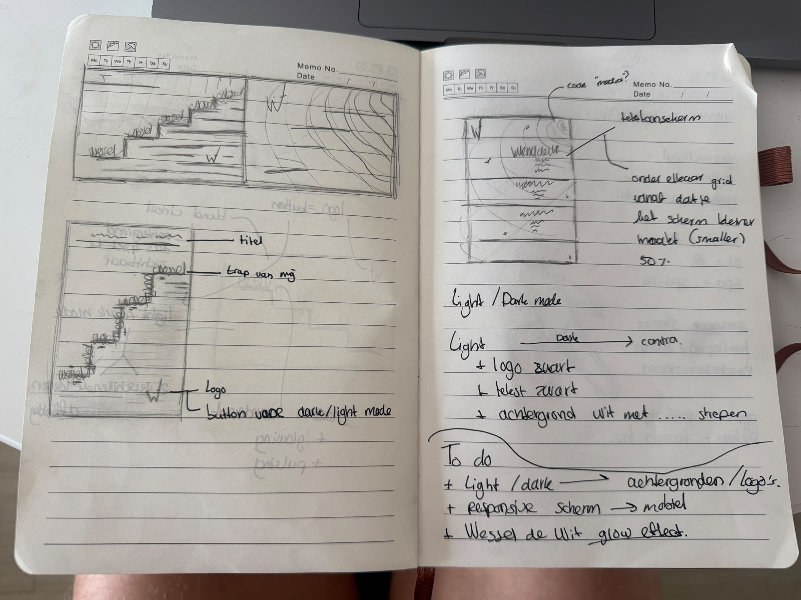

#### Ma: WS 4

1. Leg uit wanneer een website 'lelijk' wordt en geef voorbeelden wat je kan doen om deze 'lelijke' onderdelen te fixen.

Antwoord: Wanneer een website niet meebeweegt met de grootte van het scherm wordt dit als lelijk beschouwd.

2. Vertel welke volgende stap je neemt om je website responsive te maken.

Antwoord: @media

3. Kun je het ontwerp en de bouw van je eigen Garden (zo uit je hoofd) onderbouwen in Webby vocabulair?

Antwoord: Nee, dat kan ik helaas niet.

De garden moet een website zijn die toegankelijk is voor iedereen, ook voor mensen met een beperking.

Bij het coderen ben ik in eerste instantie begonnen met hetgeen ik al wist van vorig jaar. Ik heb daarbij met simpele classes alle woorden erin gezet, zodat ik ieder woord individueel kan stylen. Echter moest de site ook responsive zijn, dus ben ik met de theorie van de deep dives aan de gang gegaan. Ik heb zoveel mogelijk van wat er beschikbaar was en wat leuk zou staan op mijn site geprobeerd te gebruiken.

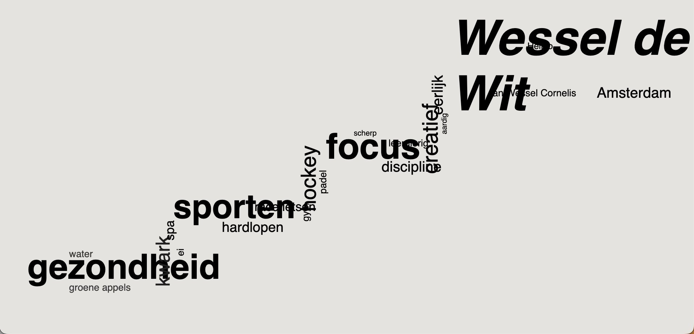

Ik had ook nog feedback gekregen van een studiegenoot. Die zei namelijk dat de lay-out heel gaaf is, maar dat de trap er niet meer helemaal mooi uitziet wanneer je het op je telefoon bekijkt. Daardoor is het niet meer leesbaar. Ook zei diegene dat er misschien iets meer kleur toegevoegd moet worden.

#### Wo: Workshop 5

1. Noem 3 Gestalt- of Design principes op en laat de ander uitleggen wat ze betekenen en doen.

Antwoord:
- Nabijheid; wanneer iets bij elkaar staat ziet het er uit als een.
- Gelijkheid; wanneer iets dezelfde vorm of kleur heeft.
- Continuïteit; wanneer lijnen of vormen dezelfde kant op gaan zien we het als een.

2. Een grid biedt ruimte om te spelen (vrijheid), maar tegelijkertijd ook eenheid en structuur (vastigheid). Wat wordt hiermee bedoeld?

Antwoord: Doordat je iets in een grid zet kan je daarmee overzicht creëren wat op verschillende groottes hetzelfde blijft.

3. Welk principe neem je mee in een laatste iteratie van je eigen Garden?

Antwoord: Doordat alle woorden op een bepaalde manier gepositioneerd zijn zie je een trap (nabijheid gestalt-principe).

#### Retrospect 1

Piek- en daltekening (foto):
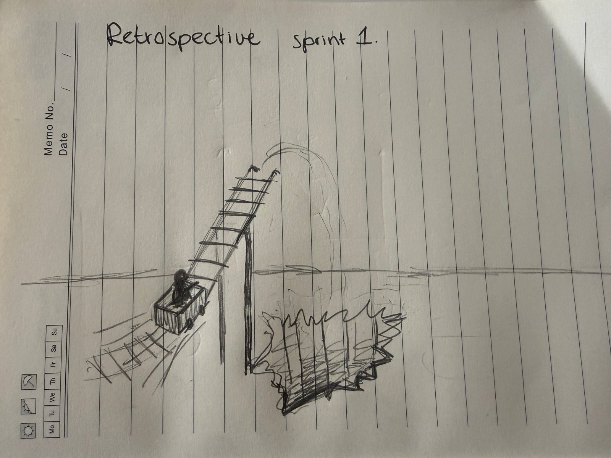
Metafoor met titel: Ontspoord op de top

Evalueren: achteraf snapte ik de opdracht dus toch niet helemaal. Ik moest iets maken over mezelf, maar het moest er ook persoonlijk uitzien, zodat je echt kon zien dat het bij mij paste. Dus dat heb ik eigenlijk gedaan. Ik had wel dingen bedacht die bij me passen, maar het waren losse woorden en je zag niet echt dat het om mij ging. Dus dat moest ik veranderen.

Daarnaast was de manier van coderen niet goed; dat was de manier van vorig jaar, dus ik moest dat helemaal aanpassen. Ik had die tekening zo gemaakt omdat ik dacht dat ik op het goede spoor zat, maar na wat feedback moest ik weer helemaal opnieuw beginnen.

Competenties:

Oriënteren en begrijpen: Ik ging meteen aan de slag nadat de opdracht was uitgelegd. Maar ik begreep de opdracht nog niet goed, dus het ging eigenlijk al meteen fout.

Evalueren: Ik kreeg feedback van de docent dat het niet goed was. Daarna moest ik helemaal opnieuw beginnen.

Prototypen en uitwerken: Ik had al schetsen gemaakt van de woordentrap. Die heb ik meteen met code uitgewerkt, maar dat was de verkeerde manier van coderen.

Vakkundig en onderzoekend ontwerpen: Na de feedback was ik gemotiveerd om het helemaal opnieuw aan te pakken, en het deze keer op de juiste manier te doen.

### Sprint 2 - Compliance

#### Ma: Begin Sprint 2

1. Wat zijn HTML landmark role elements?

Antwoord: Dat zijn elementen zoals header, footer, nav die bepaalde gedeeltes van de pagina aangeven.

2. Wat zijn heading elementen en hoe horen deze 'genest' te worden?

Antwoord: dat is de h1 tot en met h5 die horen in de header genest te worden.

3. Hoe ga jij met cookies om? Beschrijf jouw beweegredenen en of die zijn veranderd na het volgen van dit college.

Antwoord: Ik druk eigenlijk altijd zonder iets te lezen op accepteren.

##### Cookie-werkvel

De Volkskrant
Wat staat erin: dat ze informatie verzamelen over je apparaat, locatie, browser en surfgedrag.
Hoe is het ontworpen: het is heel simplistisch ontworpen en de belangrijkste dingen die zij willen, bijvoorbeeld bij het inloggen of akkoord gaan, zijn geel gemaakt.
Waarmee ga ik akkoord als ik op accepteren klik: je gaat akkoord met het geven van je gegevens, zoals die van je apparaat of locatie. De reden dat ze dit waarschijnlijk doen, is dat ze hierdoor reclames kunnen personaliseren voor de gebruiker.

Paradiso, homepage
Wat staat erin: allerlei concerten die eraan komen, een soort schema.
Hoe is het ontworpen: het is heel vrolijk, maar alsnog heel simplistisch ontworpen. De achtergrond bestaat uit een mooie groene kleur, waarin allerlei verschillende artiesten te zien zijn voor het programma. Wanneer je dan naar beneden scrolt, zie je op een heel simplistische manier op welke datum welke artiest moet optreden. De tijd staat erbij en ook of er nog kaarten te halen zijn.
Waarmee ga ik akkoord als ik op accepteren klik: als je op ‘Akkoord’ drukt, geef je toestemming dat Google je gegevens verzamelt.

Paradiso, concertpagina Songhoy Blues
Wat staat erin: er staat in wat de band inhoudt, wanneer de deuren opengaan, wanneer ze beginnen en op welke dag het is. Daarnaast zie je nog een filmpje over een muziekvideo, denk ik.
Hoe is het ontworpen: bij het drukken op de cookies kun je tussen verschillende dingen kiezen namellijk noodzakelijk, voorkeuren, statistieken en marketing. Je kunt dus zelf bepalen waarvoor je iets accepteert.
Waarmee ga ik akkoord als ik op accepteren klik: om de video te bekijken, moet je eerst de cookies aanvaarden. Als je daarop klikt, kun je de video pas zien.

#### Wo: Workshop 2

Human Consent Component

1. Bespreek in jouw groepje welke gegevens op jouw digital garden van gebruikers verwerkt worden. Houdt daarbij in de gaten welke diensten je allemaal gebruikt. Zelfs als je alles zelf geschreven hebt zijn dat er al twee: GitHub pages hosting én het digitaaltuintje component

Antwoord: Google fonts, LinkedIn link, Pinterest img, Wessels IMG, Gitub en browser. Voor de rest zijn alle afbeeldingen die ik op mijn website staat dat alles van mijzelf is.

2. Informeren van gebruikers is een plicht die je hebt als websitemaker: Hoe kan je gebruikers informeren over het gebruik van hun gegevens op jouw website?

Antwoord: Dmv een cookies pop-up bij het opstarten van je pagina.

3. Op welke manier kan je instemming vragen? Doe desk-research en zoek tenminste 10 verschillende manieren van het vragen van consent op het web.

Antwoord: Bewust aanvinken, Extra bevestiging via e-mail, Keuzeschuifjes per categorie, Twee gelijkwaardige knoppen, Toestemming vragen op het moment zelf, Verplicht naar beneden scrollen, Toestemming bij inloggen via een ander account, Stilzwijgend akkoord door gebruik, Vooraf aangevinkte vakjes en een Digitale blokkade.

4. Denk na over een manier van werken die past binnen de layout van jouw digital garden?

Antwoord: De manier waarop ik dat op mijn website ga realiseren, is door middel van allerlei zelfgemaakte schetsjes.

Check-out

1. Wat is een wireflow en wat heb je er aan?

Antwoord: Een wireflow is een schets die je maakt waarbij je de belangrijkste punten in een website probeert vastteleggen en aan te wijzen.

2. Wat zijn dark UX patterns? Geef drie voorbeelden...

Antwoord:  Fomo, Social Proof, Fake Discounting

3. Waar moet je als ontwerper rekening mee houden bij het maken van een human consent component?

Antwoord: Dat het etisch verantwoord is. Je kan niet bepaalde dingen doen, zoals bepaalde informatie automatisch akkoord geven. Niet dat geen vooraf aangevinkte vakjes die leesbaar zijn voor het toetsenbord ook kunnen weigeren.

##### Dark-pattern-herontwerp

Gekozen site: Booking.com

Huidige consent-flow en dark patterns (foto):

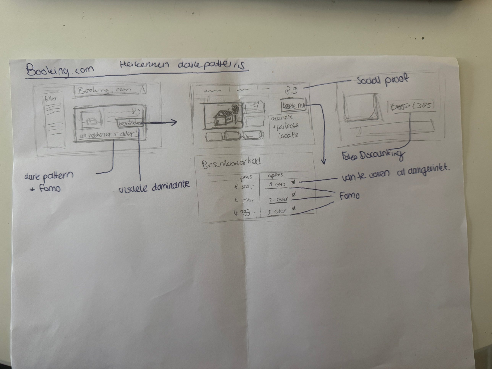

Darkpatterns: op de site herken je verschillende dark patterns. Dingen die je vooral ziet, zijn bijvoorbeeld FOMO. Ze proberen je door schaarste aan te geven sneller over te halen om iets te kopen.Daarnaast heb je ook social proof. Ze geven bijvoorbeeld een cijfer aan iets, waardoor je denkt dat het beter is, terwijl dat misschien wel op niks gebaseerd is. Ook heb je ook fake discounting. Dat houdt in dat ze doen alsof ze iets heel goedkoop hebben afgeprijsd, terwijl dat in werkelijkheid helemaal niet zo is. Het lijkt dus alleen maar zo.

Herontwerp (foto):

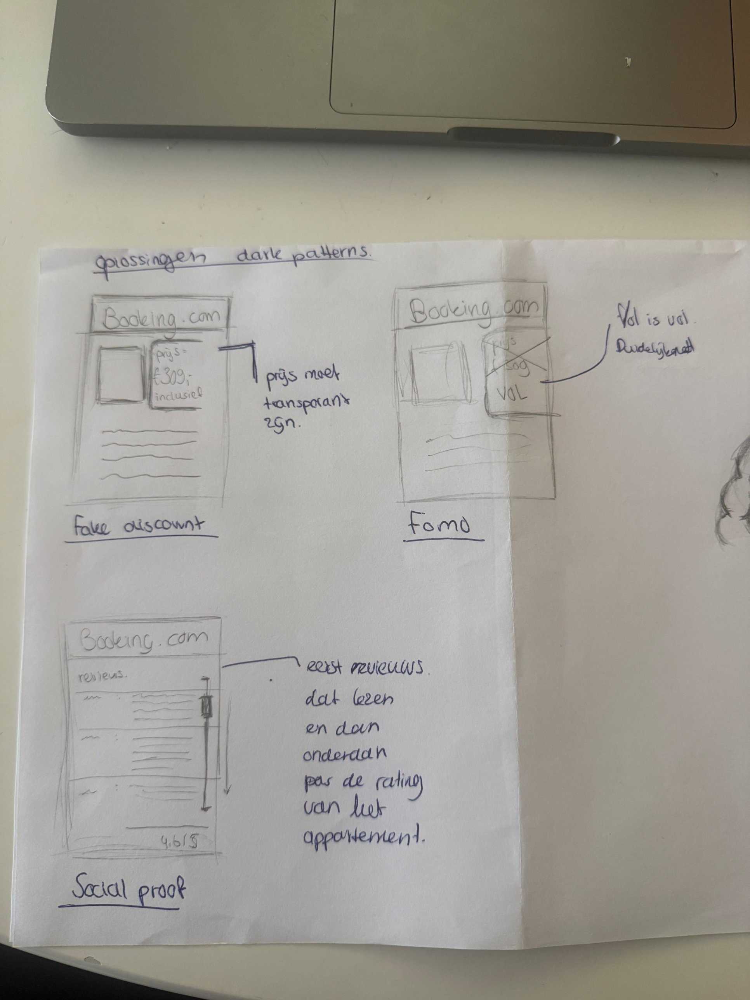

Wat ik heb veranderd en waarom: het eerste wat ik heb veranderd, is de prijs. Die moet gewoon transparant zijn. Er moet geen fake discounting op zitten. Dat is niet goed. Je moet ook geen FOMO creëren bij de klant. Je moet gewoon heel duidelijk zijn over wat het is. Je moet niet zeggen dat er nog vijf plaatsen of plekken beschikbaar zijn; je moet gewoon zeggen: het is beschikbaar of het is vol.

Misschien is het eerst handig dat er geen cijfer aan gekoppeld is, maar dat je wel reviews kunt zien. Misschien zie je helemaal onderaan de reviews dan een cijfer, zodat je eerst zelf gaat kijken wat mensen ervan vinden en er daarna pas een cijfer aan gekoppeld wordt.

Opmerking filmpje Dan Saffer: ik vond het een beetje een outdated filmpje. Het was van 12 jaar geleden en hetgeen wat ze daarin zeggen, is natuurlijk nog steeds relevant, maar er zijn vast wel filmpjes die micro-interacties laten zien hoe het nu allemaal is in plaats van hoe dat vroeger allemaal ging.

##### Wireframes en wireflow cookie-pop-up

Mobiel (foto):

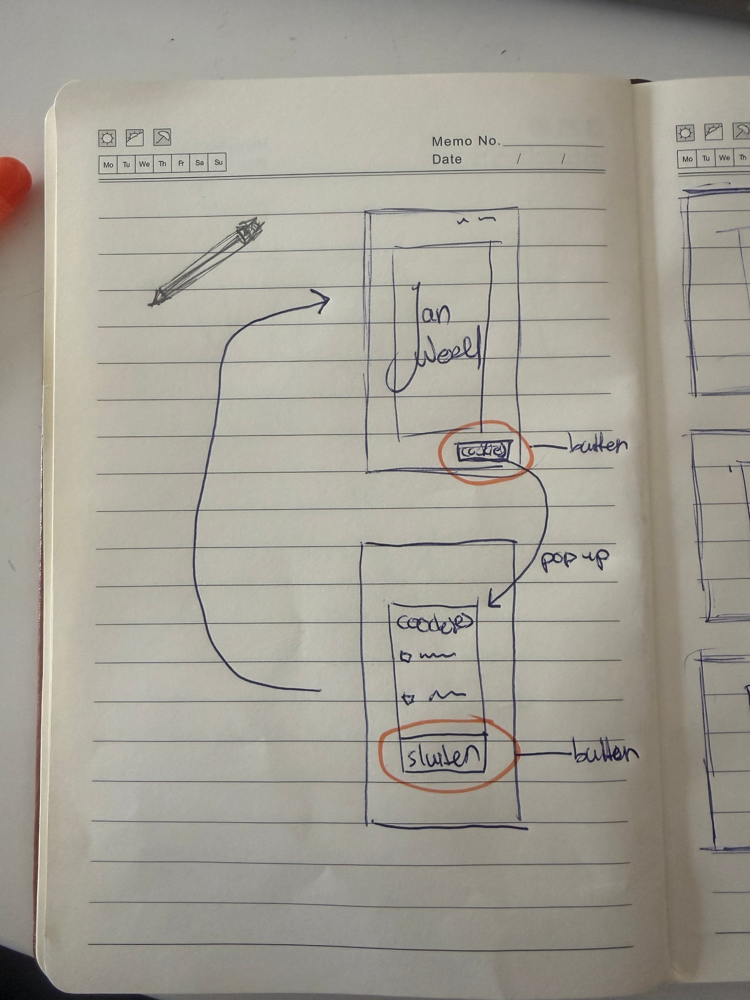

Laptop (foto):

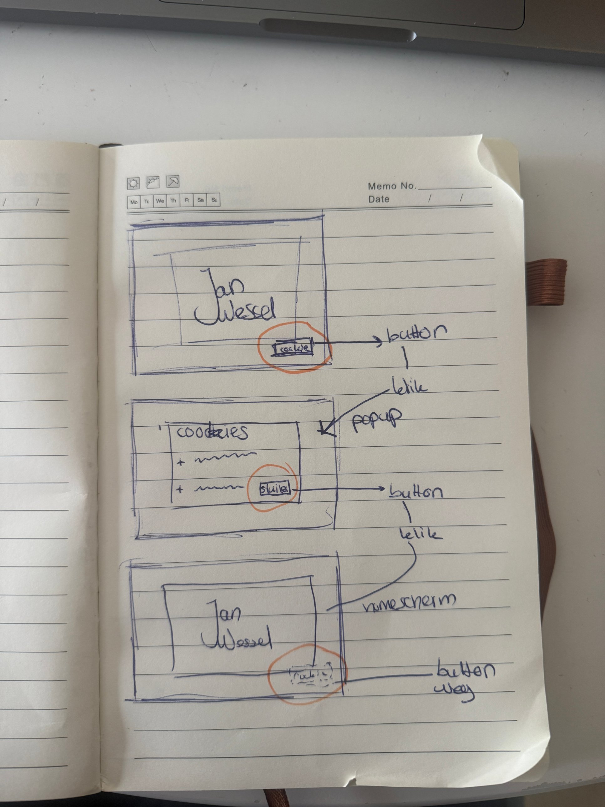

Waarom twee formaten:
Ik heb maar twee formaten gedaan, omdat ik het gebaseerd heb op een telefoonscherm en een laptopscherm. Daartussen zit voor mij niks. Zodra het scherm een bepaald percentage krimpt, schakelt het gewoon over naar de telefoonmodus. Zo ook andersom.

#### Vr: Geautomatiseerd testen + Voortgang

##### W3C-validatie

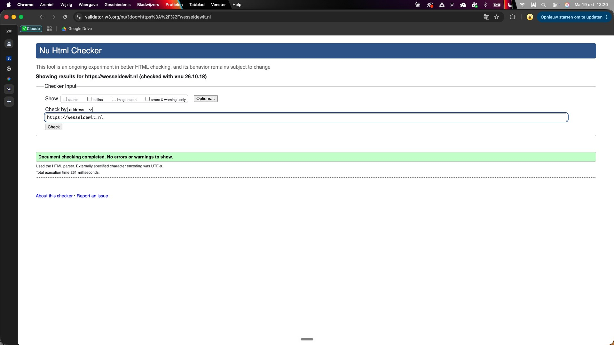

Ik heb niet alleen mijn homepagina op de foto gevalideerd, maar ook alle andere HTML-bestanden in de HTML-checker gecontroleerd. Daarbij kwam geen enkele foutmelding naar voren.

1. Wat is HTML validatie, waarom is het belangrijk en hoe heb je dat vandaag uitgevoerd?

Antwoord: het is belangrijk, omdat het leesbaar moet zijn voor iedereen.

2. Welke dingen vielen je op?

Antwoord: in eerste instantie viel het mij op dat je alles moet labelen, zodat  bijvoorbeeld een afbeelding ook leesbaar is.

3. Welke feedback heb je ontvangen tijdens het gesprek met je docenten?

Antwoord: Justus zei: “Als iets niet leesbaar is, kan het ook niet fout zijn.” Daardoor heb ik ervoor gezorgd dat alles leesbaar is voor de computer. Uiteindelijk heeft dat ertoe geleid dat er geen fouten meer in zitten en dat het wel leesbaar is.

#### Ma: Handmatig testen + Bi-weekly geek 2

##### NS-reis plannen

Alleen toetsenbord
Wat goed ging, is dat ik via tap heel gemakkelijk door de gehele pagina kon klikken. Het ging op zich wel gemakkelijk. Wat ik vooral gebruikte, was Tab, Shift+Tab, Pijltjes en Enter. Met deze toetsen de reisboeken. Wat ik wat lastiger vond, is dat er op een gegeven moment een pop-up kwam met de vraag wie mijn locatie wilde hebben en of ik die wilde delen. Met mijn toetsenbord kon ik niet door die knoppen klikken, omdat het misschien een pop-up van mijn eigen laptop was en niet van de site zelf.

Met VoiceOver

Ik vind dit een stuk minder efficiënt dan wat je met het toetsenbord hebt. De voice-over praat heel snel en heeft een robotstem die ik moeilijk te verstaan vind. Daarnaast vind ik dat hij ook bepaalde dingen voorleest die voor mijn gevoel niet heel relevant zijn. De knoppen die ik vooral heb gebruikt, zijn Command+F5 om het voorlezen te beginnen en Ctrl om het te stoppen.

Spiekbrief toetsenbord en VoiceOver:

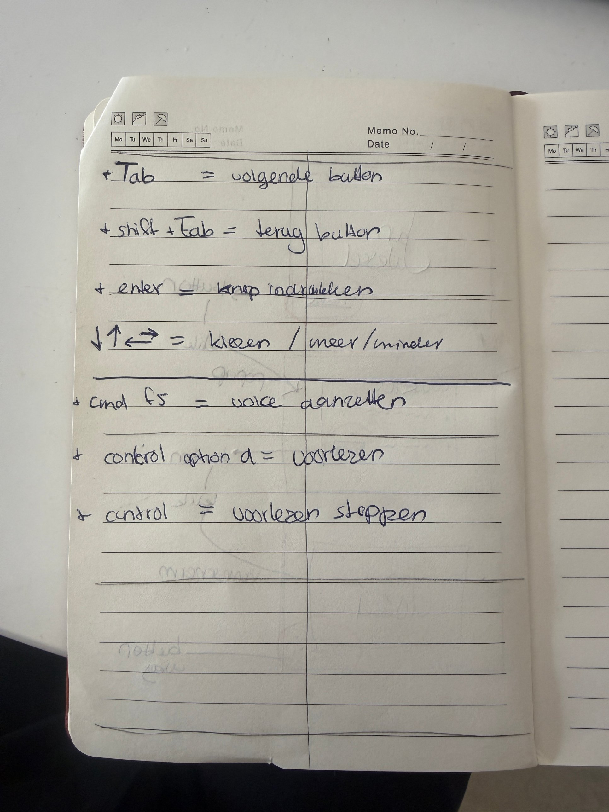
Vergelijking, wat was lastiger en waarom: ik vond de voice-over een stuk lastiger dan navigeren met het toetsenbord. Je moet echt meer je aandacht erbij houden om de voice-over bij te houden dan wanneer je een toetsenbord gebruikt. Dat kun je gewoon op je eigen tempo doen.

1. Wat bedoelt Vasilis met de uitspraak: Semantiek doet mij niet zo veel, ik ben liever bezig met de UX van HTML?

Antwoord:  dat betekent dat het belangrijker is dat het goed bruikbaar is voor de gebruiker dan dat het, zeg maar, code-wise helemaal klopt.

2. Wat voor type beperkingen hebben invloed op het gebruiken van websites?

Antwoord: je moet hierbij denken aan mensen die blind of doof zijn of niet zo goed kunnen lezen. Je moet ook bedenken dat er mensen zijn die geen handen hebben of hun arm hebben gebroken. Dus die moeten ook de website kunnen besturen. Het moet dus allemaal makkelijk zijn voor mensen met een beperking.

3. Noem drie manieren om door een website te navigeren met jouw screenreader.

Antwoord: je kan door de koppen heen, dus bijvoorbeeld vanaf de belangrijkste koppen H1 en H2, of via de links. Dan ga je alleen de links door, of je doet het via de headernavigatie, main of footer.

#### Wo: User testing en A11Y

##### Drie toegankelijkheidstests

Test 1, screenreader
Kopstructuur logisch: Ja, de kopstructuur is logisch. Je ziet namelijk alle pagina's in het menu staan.
Alle interactieve elementen te vinden: ja, alles is goed te vinden. Alle elementen en links zeggen precies waar ze heen gaan. Ik liep eigenlijk nergens tegenaan.
Screenshot:
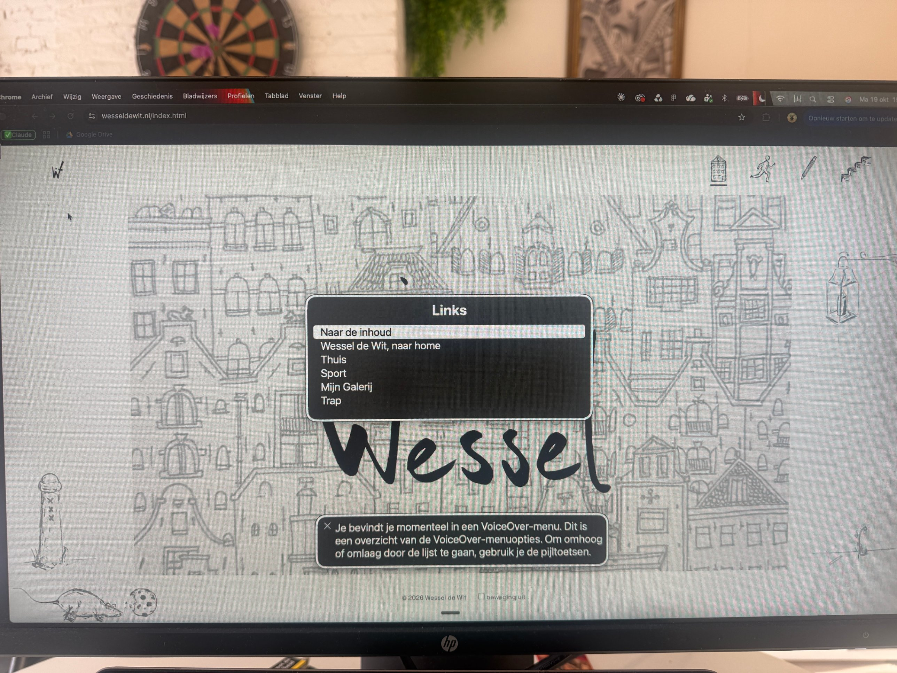
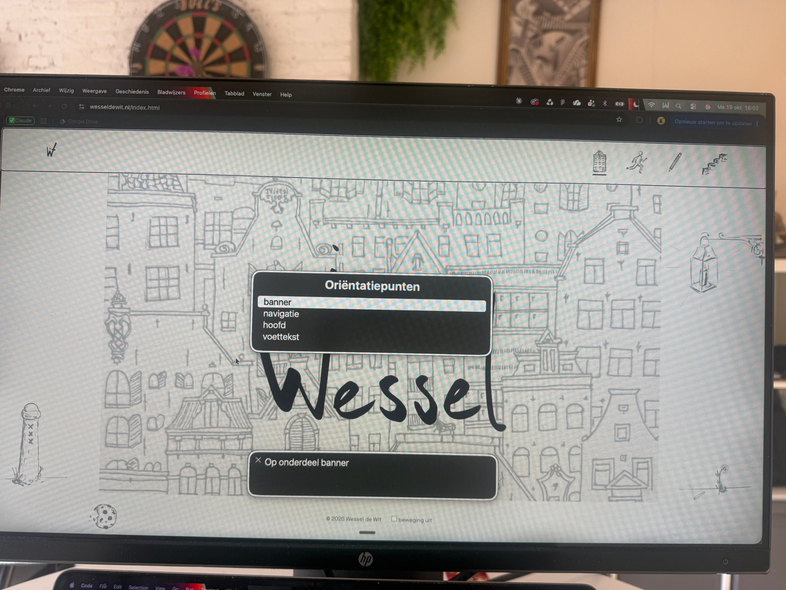
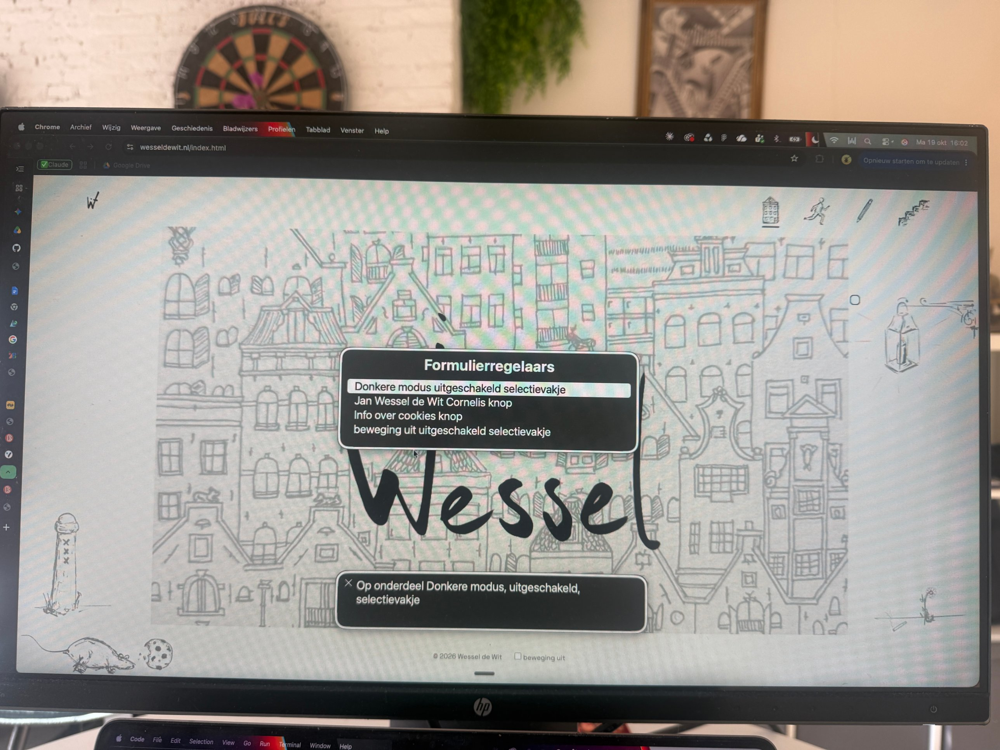

Test 2, alleen toetsenbord
Alles bereikbaar: In principe is alles wat een knop is bereikbaar, behalve de dark- en lightmode knop, die is niet via Tap bereikbaar. De volgorde is goed: het gaat van boven naar beneden, van links naar rechts. Links bovenin staat 'terug naar inhoud'. Als je daarop klikt, ga je gelijk vanuit de menubalk naar de inhoud.

Test 3, WCAG-checklist:

Contrast gecontroleerd met:

Controle 1, hoofdtekst light ( #1a1a1a op #f4f1ea): ratio 15,42, voldoet wel

Controle 2, hoofdtekst dark ( #f4f1ea op #2e2e38): ratio 11,9, voldoet wel

Controle 3, gele terriers ( #c4930d op #f4f1ea): ratio 2,47, voldoet niet

Er zijn een aantal dingen die ik heb gecheckt. Ik heb de hoofdtekst gecheckt op de achtergrondkleur. Die voldeed zeker bij de light mode. Dat heb ik ook gedaan bij de dark mode.

Daarnaast was ik ook benieuwd naar een kleur waar ik een beetje over twijfelde bij de sportpagina, die van hockey. Die kwam er niet doorheen. Ja, het ding is alleen: ik wil wel graag die kleur geel gebruiken, omdat dat bij Terriers past.

Ik heb daarna wat onderzoek gedaan en de gele kleur komt bijna nooit boven een ratio van 4,5 op een crème/witte achtergrond. Dus ja, dan accepteer ik dat dat niet goed is.

Screenshot:
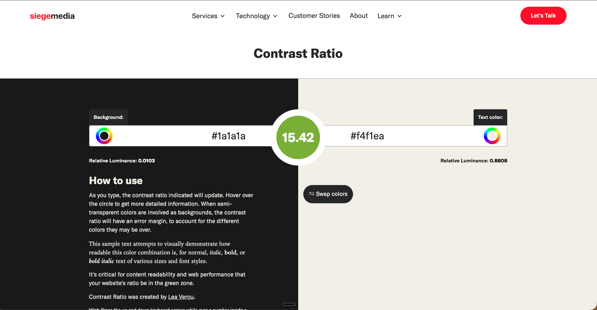
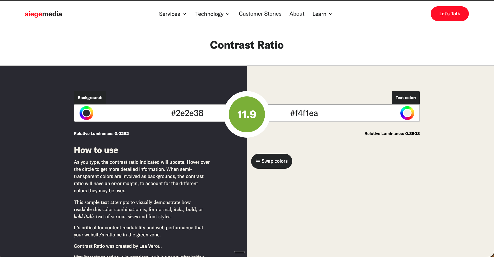
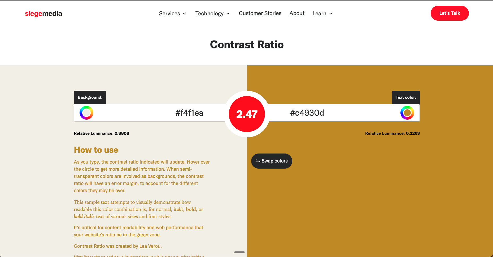

1. Waar staat WCAG en A11y voor?

Antwoord: de eerste staat voor Web Content Accessibility Guidelines. Dat houdt in wat de standaarden zijn die internationaal worden gebruikt voor de toegankelijkheid van websites. Soort wetboek voor webdesigners en developers.

En de tweede, A11y, dit gaat over toegankelijkheid, accessibility. Het is een soort afkorting daarvan. Term in webdesign wereld.

2. Wat vind je lastiger, je laptop/websites alleen met een toetsenbord bedienen of met een screenreader? Waarom? Waar moet je nog mee oefenen?

Antwoord: ik vind het makkelijker om via toetsenbordnavigatie door de pagina heen te gaan. Daar haal ik meer uit dan wanneer ik de HTML van een pagina zie.

3. Met welke beperking rekening houden vind je het meest lastig? Vind je dat je beperkt wordt in wat je kunt ontwerpen? Of heb je al manieren gevonden om vanuit een solide basis - die voor iedereen toegankelijk is - allemaal leuke en mooie extra's toe te voegen als je bezoekers dat goed vinden?

Antwoord: ik vind het kleurcontrast misschien wel het lastigst, want ik ben zelf natuurlijk niet kleurenblind. Er zijn natuurlijk mensen die bijvoorbeeld het verschil tussen gele accenten en wit niet zien, waardoor het voor hen niet leesbaar is. Je probeert natuurlijk wel een website voor iedereen te maken.

#### Vr: Voortgang + Retrospect

Piek- en daltekening (foto):
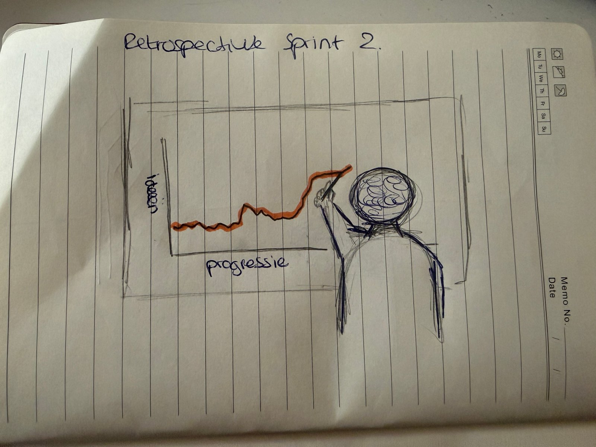
Metafoor met titel: Zoeken naar mezelf

Uitleg bij de tekening: in de tekening zie je mijn voortgang van die sprint qua ideeën. Ik had natuurlijk eerst een aantal ideeën, maar dat was niet goed. Dus toen moest ik het op een andere manier doen. Ik was daar vooral mee bezig: bedenken hoe ik dan wel een site kon maken die gebaseerd is op wat ik allemaal leuk vind en wat bij mij past.

Toen kwam ik eerst op het sportgedeelte, maar ik vond het nog een beetje saai en wilde nog een andere kant van mezelf laten zien. Ik heb ook een aantal schilderijen gemaakt, dus daarmee kon ik ook mijn creatieve kant laten zien.

Competenties:

Verbeelden en conceptualiseren: Ik had al meteen een idee van wat ik wilde doen, met waar ik in het dagelijks leven mee bezig ben: sport en een gezonde levensstijl. Daarnaast wilde ik ook een creatieve kant van mezelf laten zien. Dat heb ik gedaan met de tekeningen en schilderijen die ik heb gemaakt.

Persoonlijk en geëngageerd ontwerpen: Ik heb een site gemaakt die echt heel persoonlijk is. Dat was ook de bedoeling en de feedback die ik had gekregen. Daarnaast is de site toegankelijk. Doordat ik alles leesbaar heb gemaakt, kunnen mensen met een beperking, zoals blinde mensen, er goed doorheen scrollen. Ook mensen die slechtziend of kleurenblind zijn, kunnen alles goed lezen en zien op mijn website.

Prototypen en uitwerken: Ik heb verschillende schetsen en wireframes gemaakt voor de cookie-pop-up en voor de hele website en de verschillende pagina's, zoals de sportpagina. Dat heb ik eerst geschetst en daarna in code uitgewerkt.

Evalueren: Ik heb toegankelijkheidstesten gedaan, bijvoorbeeld met de W3C-validator, maar ook met VoiceOver en met alleen het toetsenbord en Tab. Daar kwam ik voor de rest goed doorheen, behalve dat ik met Tab niet bij mijn dark- en lightmodeknop en niet bij mijn Over mij-knop kwam.

### Sprint 3 - De regels & het spel

#### Ma: Check-out typografie

Kerning: wat je met kerning kunt doen, is bijvoorbeeld bij grote letters, zoals bij mijn naam, de W en de E dichter naar elkaar toe trekken. Er kan namelijk nog weleens ruimte tussen zitten. Met kerning zorg je ervoor dat die twee individuele letters dichter bij elkaar komen, zodat er minder ruimte tussen zit.

Tracking: wat je met tracking kunt doen, is de ruimte tussen de letters van specifiek woord uit elkaar trekken voor een geinig effect.

Leading: met leading kun je de ruimte tussen de regels wat groter maken, zodat het niet zo erg op elkaar zit.

Flush-left: hierbij begint alles precies links, omdat lezen van links naar rechts het makkelijkste is. Dat zijn wij namelijk gewend.

Flush-right: dit kun je het best gebruiken voor losse woorden om ze aan de rechterkant te zetten.  

Centered: hiermee staat alles netjes in het midden gecentreerd. Het is symmetrisch.

Justified: hiermee kan je zowel links als rechts kaarsrechte teksten/kolommen.

Indent: dit gebruik je wanneer je een nieuwe alinea begint. Dan heeft die een spatie. Dan springt die even een klein stukje naar rechts toe, zodat je ziet dat er een nieuw stukje tekst begint.

Outdent: hierbij gaat hij een beetje naar de buitenkant, dus buiten de kolom, buiten de alinea.

Modular scale: brengt harmonie en orde

Movable type: zo deden ze het vroeger: losse letters.

Focuspunt: het punt dat in je ontwerp/design het meest naar voren komt.

De vijf soorten contrast: kleur, grootte, vorm, witruimte, gewicht

Spatial tension: dit creëer je door asymmetrisch te werk te gaan. Dus door bepaalde ruimtes aan de ene kant meer open te houden dan aan de andere kant, grotere lettertypen of een andere kleur te gebruiken.

Mijn ideale regellengte (measure) en waarom: ik heb niet per se een precieze ideale regellengte, maar waar ik wel van houd, is dat het goed leesbaar is. Dat zit ,meestal tussern de 45 en 75 tekens.Hoe doe ik dan tegen praten?  Ik wil niet dat het te groot is, maar het moet er wel heel clean uitzien, vind ik. Dus ik wil het liefst dat het er redelijk klein uitziet, maar alsnog wel leesbaar is.

Mijn ene variabele voor hiërarchie en waarom:  hierin vind ik plaatsing heel belangrijk. Onder andere in de songtekst die ik heb gemaakt, maar ook in mijn digital garden vind ik het belangrijk dat alles in mijn ogen op precies de juiste plek staat, zodat het een mooi geheel is. Bijvoorbeeld met al mijn schetsen op mijn website, want als die niet op de juiste plek staan, klopt het beeld/achtegrond van de pagina niet.

##### Song en schetsen

Nummer en gekozen stuk tekst: het nummer dat ik heb gekozen, is Let It Happen van Tame Impala. De tekst die mij daar het meest aansprak, is: “All this running around, I can't fight it much longer.”

Hoe voelt het nummer (drie woorden): opbouwend, rustig en spacey

Mijn schetsen (foto's):

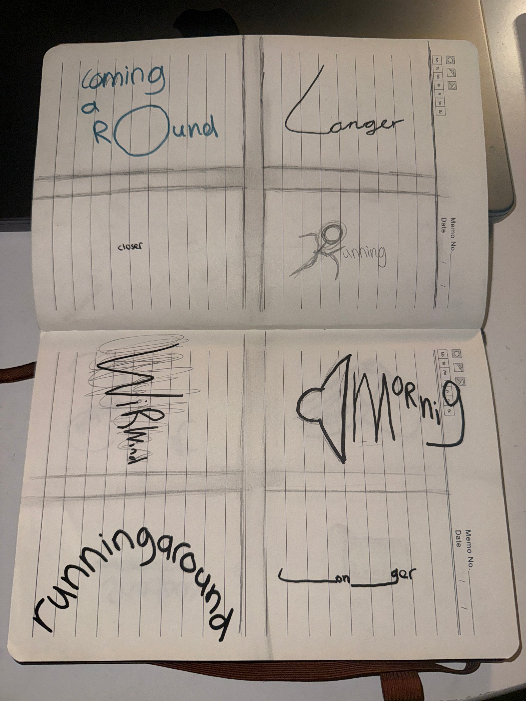

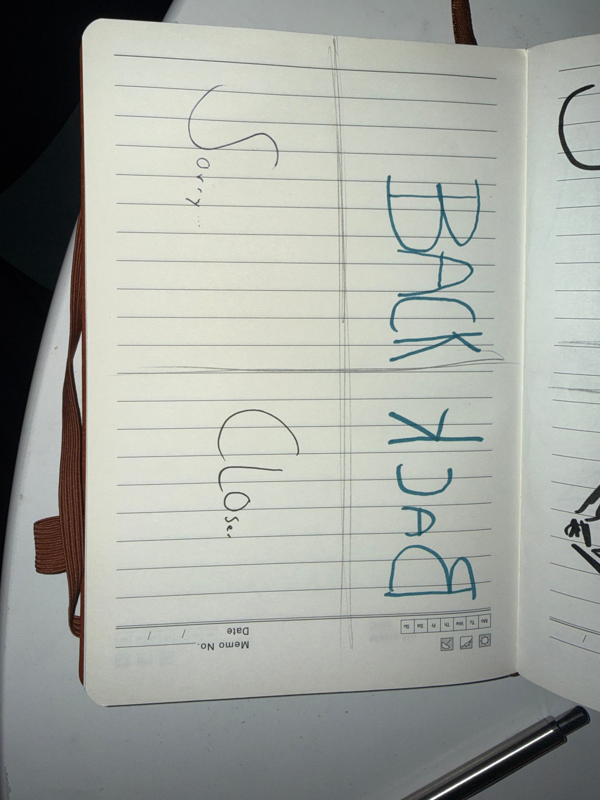

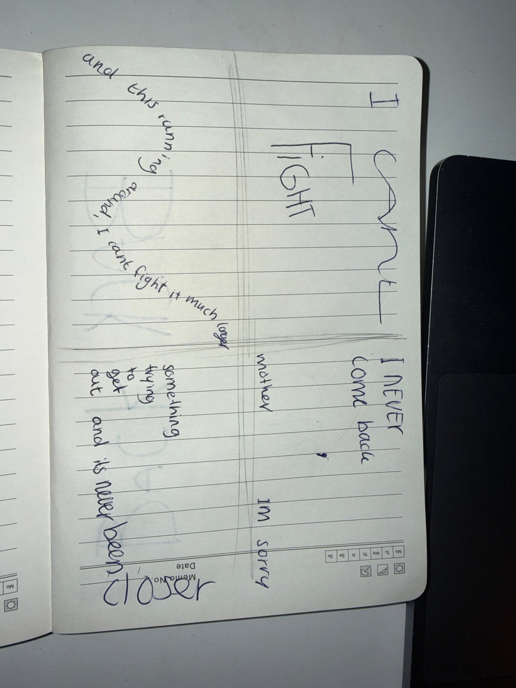

Wat doet de opmaak met de tekst (per schets kort): in de schets heb ik proberen te spelen met losse woorden, maar ook met de zinnen zelf. Met losse woorden heb ik bijvoorbeeld bij coming around ervoor gezorgd dat de O wat groter is dan de rest, zodat het round is. Bij longer heb ik de L heel lang gemaakt, zodat het er ook longer uitziet. Bij word closer heb ik het heel klein neergezet, zodat je echt dichtbij moet kijken om het te zien.

Welke schets ga ik digitaal bouwen en waarom: Ik heb de schets gekozen waarin de tekst in een soort rondje staat. Dus ik heb het op die manier gepositioneerd. Iets wat je nog leuker zou kunnen maken, is de tekst of de woorden zelf ook buigend maken, of dat je animaties heeft aan de tekst zodat er meer beweging in zit.

#### Wo: Hiërarchie en Grid

In deze workshop ging het over hiërarchie en grid. Met grootte, dikte en letterafstand laat je zien welke woorden het belangrijkst zijn. Met grid zet je ze precies op een plek. Ik heb de woorden van mijn songtekst in een boog gezet met grid-column en grid-row.

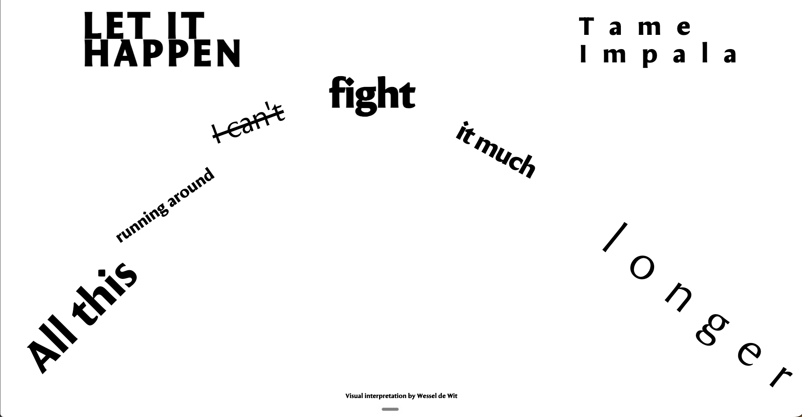

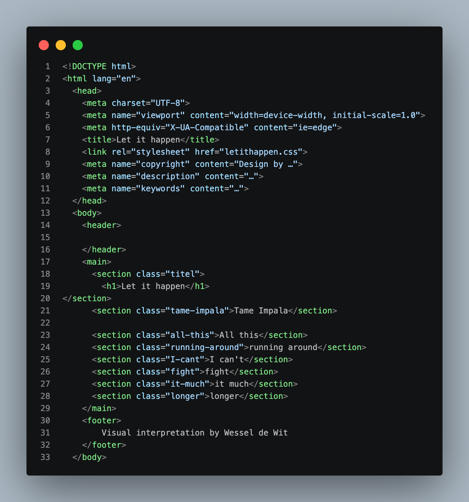
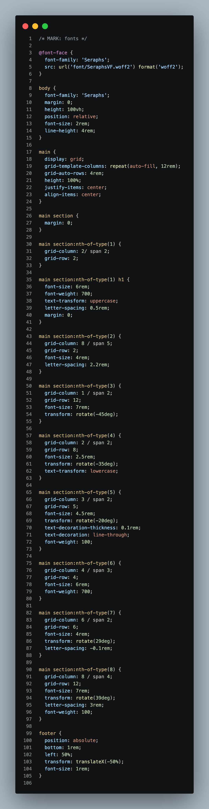

#### Vr: Variable fonts

Op mijn songtekstpagina gebruik ik het font Seraphs. Dat is een variabel font, dus je kunt de vorm van de letters zelf aanpassen. Couplet 1 is strak, het refrein heeft voetjes en couplet 2 is rond. In de titel verandert de vorm langzaam, alsof hij loslaat. Dat heb ik uit de deep dive Variabele fonts van Sanne.

##### Animatie

Ik heb hierbij in mijn songtekst gewoon allemaal probeersels gemaakt met verschillende animaties. Hierbij wist ik dat het een opzetje zou zijn en dat ik later nog een echte versie hiervan zou maken.

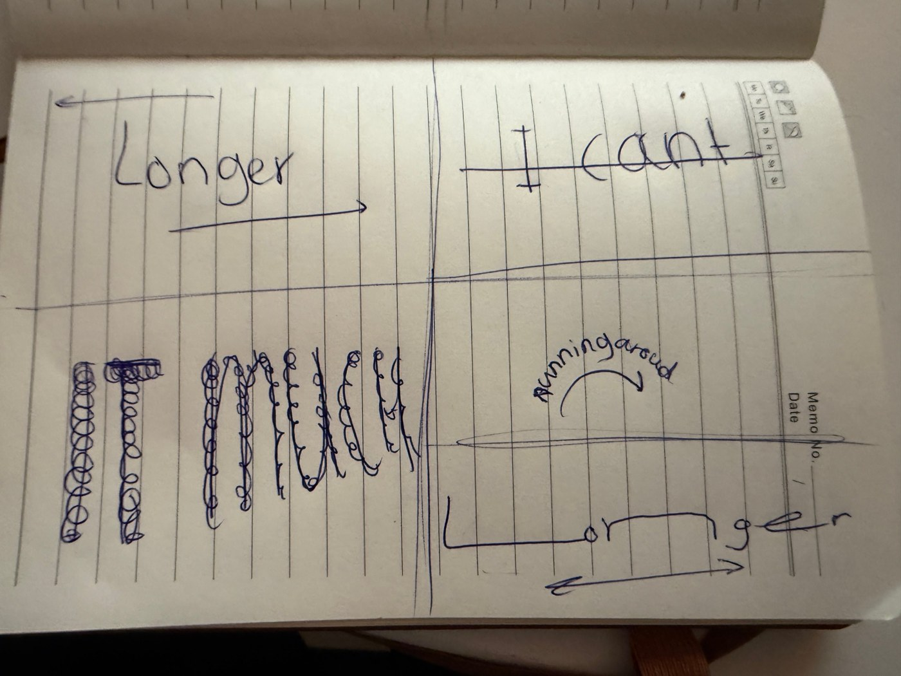

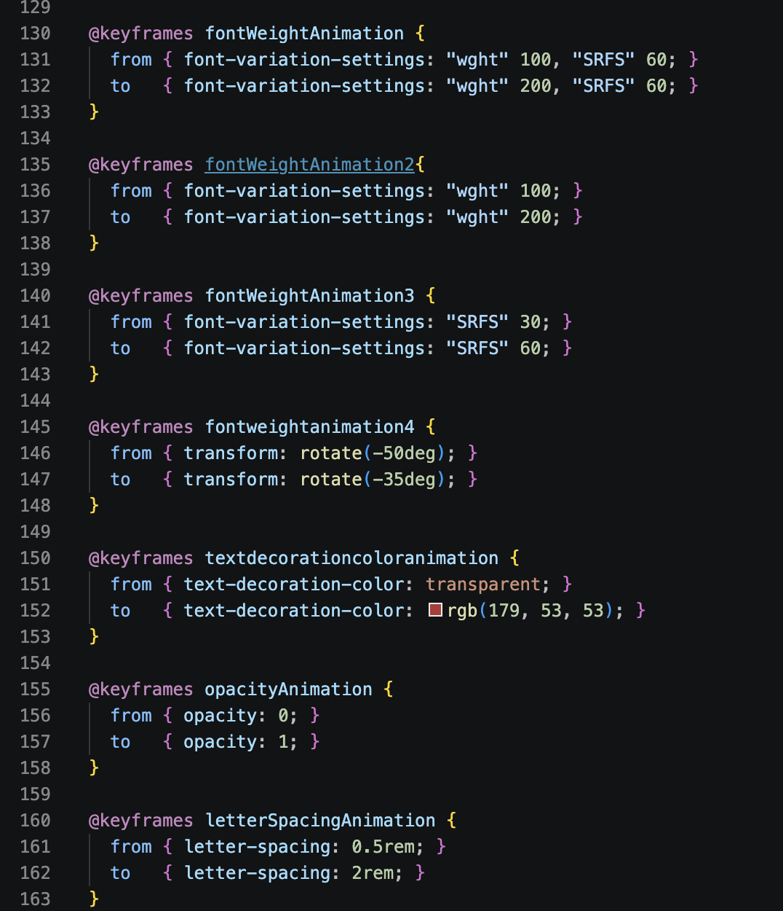

#### Ma: Bi-weekly geek 3

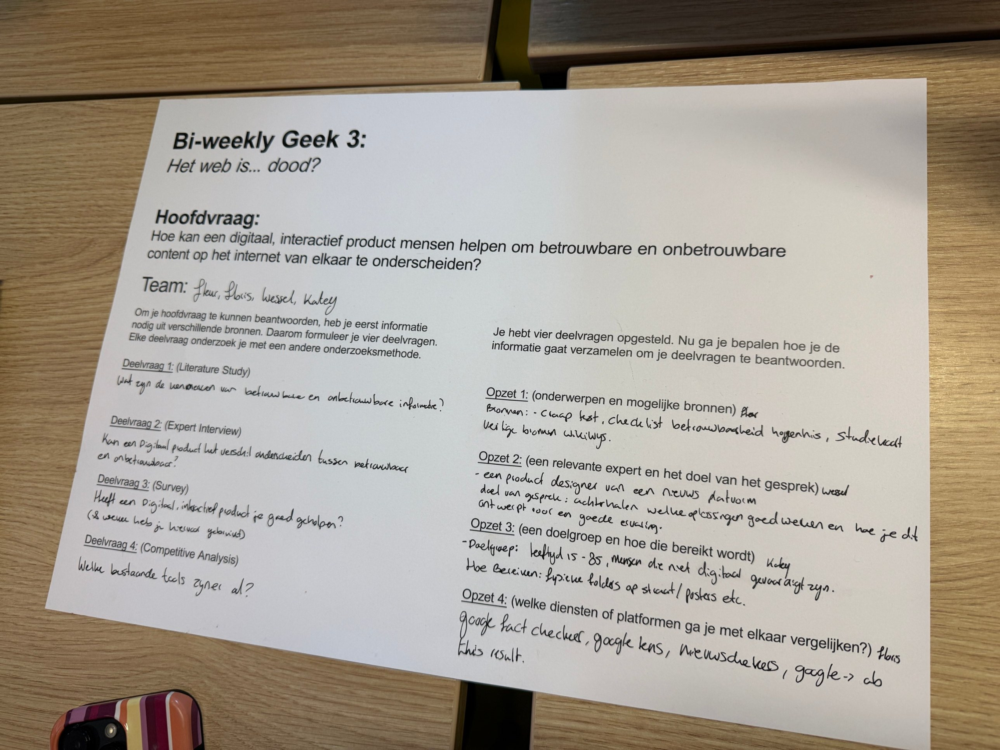

Hier moeten we samen gaan kijken naar hoe je de betrouwbaarheid of onbetrouwbaarheid van een product kunt vergelijken en wie daarin de beste vergelijking kan maken.

#### Wo: Dotting the i's

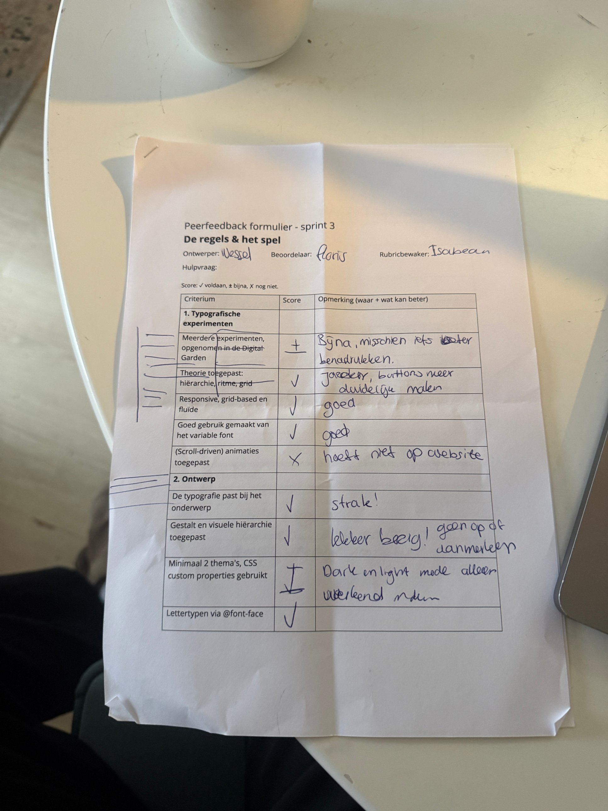

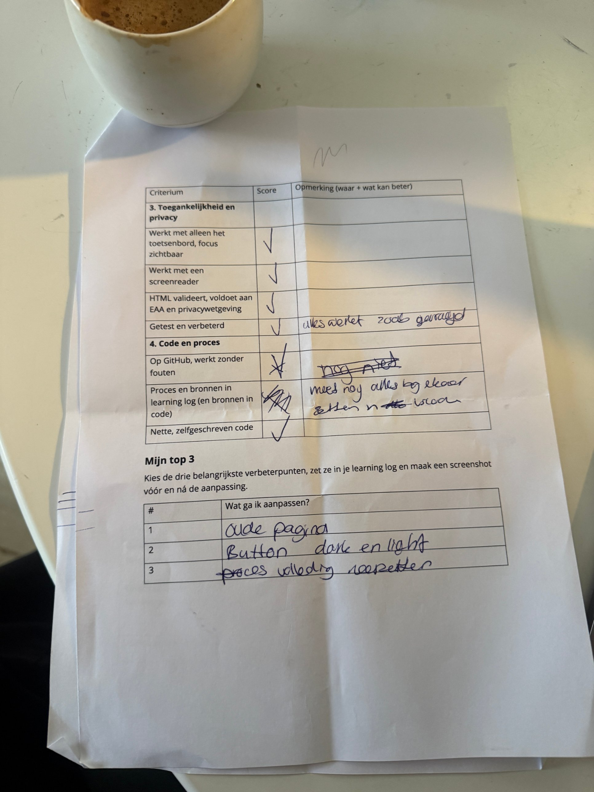

Hieruit is gekomen dat ik de pagina van de woordentrap er misschien wel uit moet halen. Dat is natuurlijk het begin van mijn pagina geweest, maar dat staat helemaal niet in lijn met de rest van mijn website.

Daarnaast moet ik misschien kijken naar de buttons voor de dark- en lightmodus. Wanneer ik deze activeer, wordt de modus alleen op de website zelf aangepast. Wanneer dit vanuit de instellingen op je telefoon of desktop wordt gedaan, gebeurt dat niet.

Daarnaast moet ik het proces van het bouwen van de website nog helemaal in de README zetten. Dat staat er inmiddels in, onder Proces van het maken van de site.

#### Songtekstversies in mijn website

##### Versie 1

Schetsen: zie Song en schetsen hierboven.

Code:

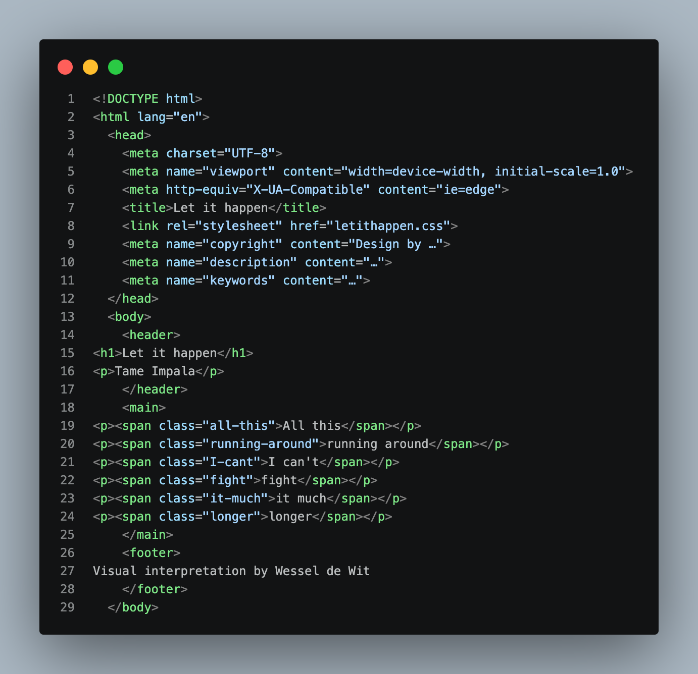
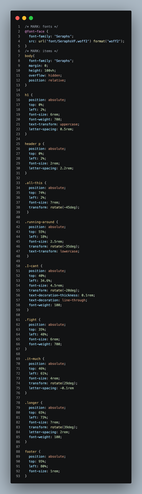

Resultaat:  In eerste instantie ben ik op basis van de tekst zelf gaan schetsen, dus niet per se op basis van de muziek. Daarin had ik de woorden “coming around”, dus wilde ik daarmee de rol of vorm creëren die ik in mijn site heb gebruikt.

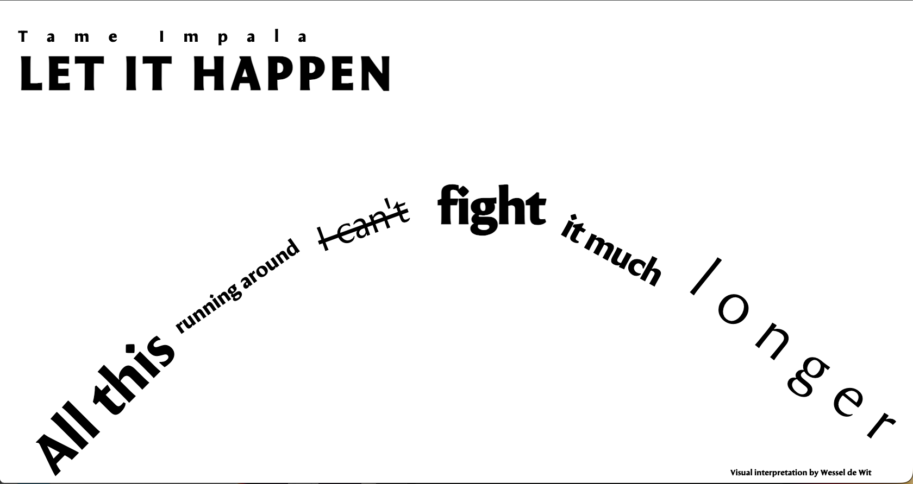

Feedback docent: De docent heeft als feedback op mijn song gezegd dat het meer moest gaan over welk gevoel de song zou moeten overbrengen. Dus ik denk daarbij aan of het iets hards of zachts is. Of dat moet je dan vertalen in harde of zachte vormen.

##### Versie 2

Schetsen: Wat ik heb geprobeerd in de schetsen, is kijken naar wat voor dingen ik wil laten zien en hoe het geluid iets kan vertalen in beeld. Daarbij heb ik de focus gelegd op bepaalde woorden. De animatie die ik heb gemaakt, heb ik op een langzame, speculatieve manier gemaakt. In mijn schetsen ben ik gaan bedenken hoe en wat, en dat heb ik later digitaal gerealiseerd.

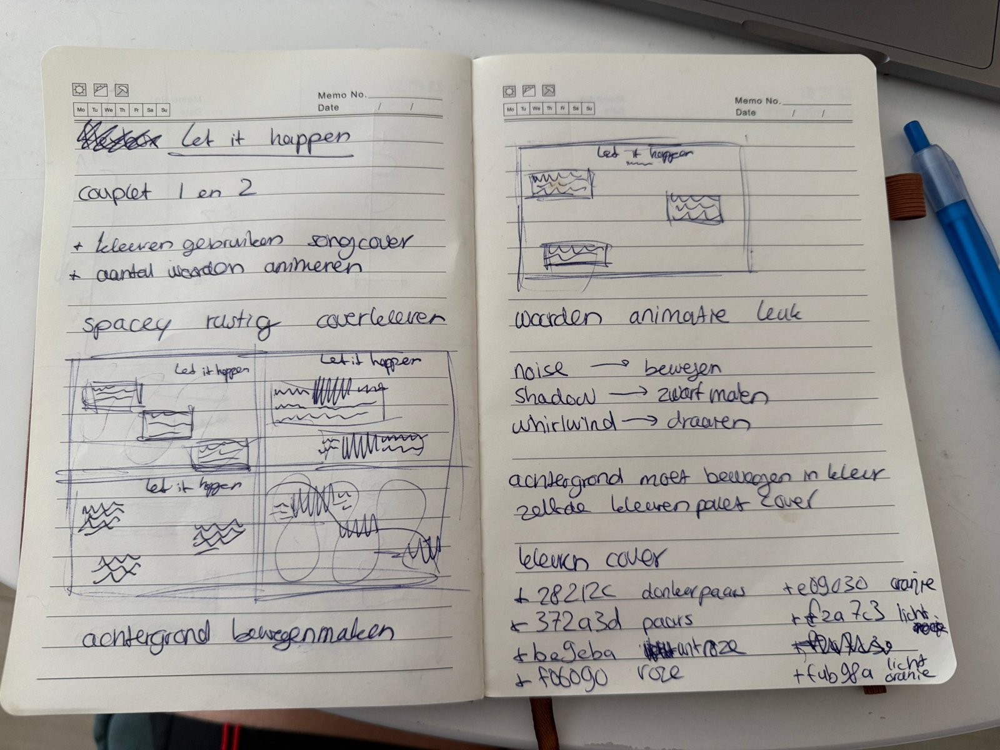

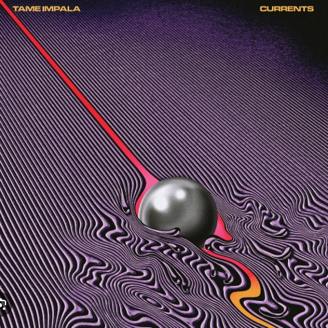

Resultaat: Waar ik voor gegaan is het creeeren van een rustige maar wel een beetje spacende pagina. De reden hiervoor is omdat ikzelf dat gevoel krijg bij het nummer en ik dat wilde overbrengen naar de kijker op mijn website. Ik heb hierbij veel inspiratie gehaal duit de cover van het album. De kleuren die hierin zijn gebruikt heb ik overgenomen en daarmee de woorden en achtergrond van mijn website gestyled. Bij het animeren van de woorden en tekst heb ik er voor gekozen om alles rustig te houden. Rustige bewegingen wat goed het idee vanm de song overbrengt.

Ik wilde dat de tekst niet gewoon in een rijtje stond. Daarom staan de coupletten links en het refrein rechts in een grid van 12 kolommen. Dat heb ik uit de deep dive Interessantere layouts van Vasilis.

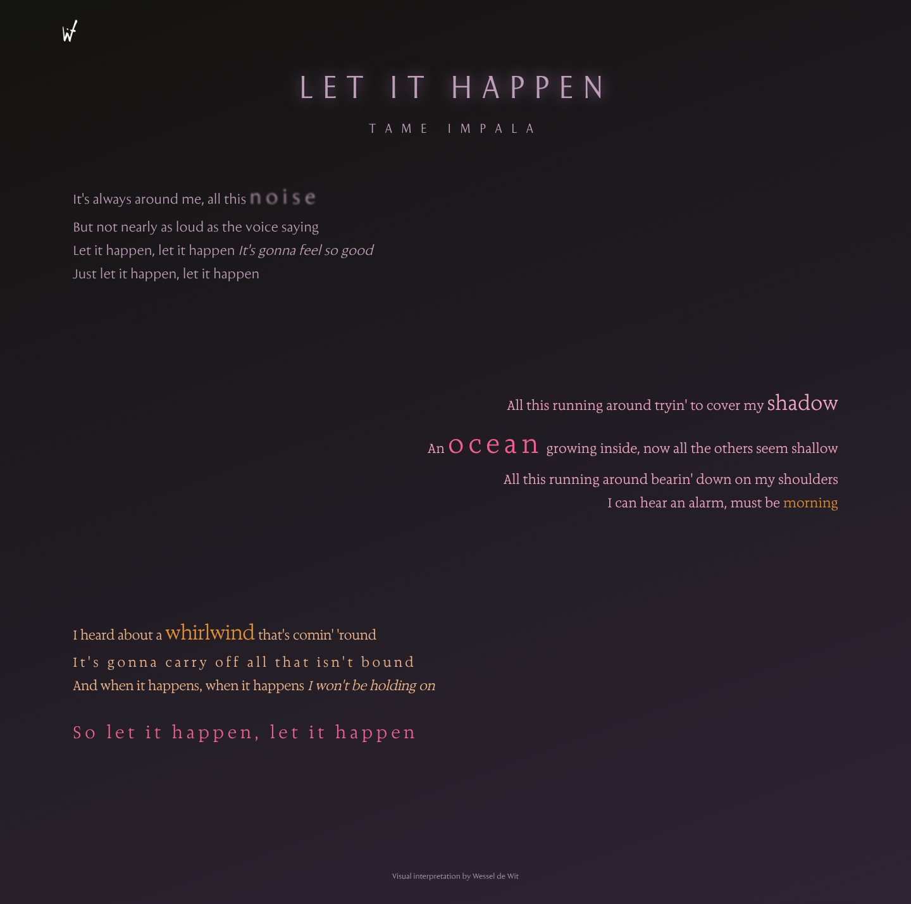

#### Retrospect 3

Piek- en daltekening (foto):
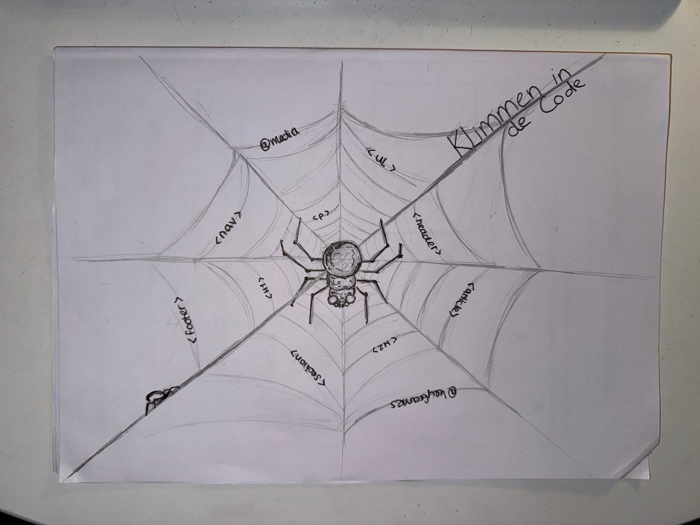
Metafoor met titel: Klimmen in de Code

Uitleg bij de tekening: In de tekening zie je een duidelijke lijn van linksboven naar beneden. Dat is mijn leercurve. Vanaf het begin wist ik al een beetje wat coderen inhield en hoe je een website in elkaar zet, maar het was nog niet op de juiste manier. Een spinnenweb is ook een web, dus het heeft een dubbele betekenis. De spin vangt allerlei soorten code op die ik de afgelopen weken heb geleerd, zoals header, nav, section, article, @media en @keyframes. Daardoor heb ik uiteindelijk de site die ik nu heb.

Competenties:

Prototypen en uitwerken: Ik was begonnen met songtekst versie 1. Daar kreeg ik feedback op van Nicky dat er meer gevoel bij moest komen. Daarna ben ik aan de slag gegaan met versie 2. Die heb ik ook allemaal geschetst en zo geëvalueerd.

Evalueren: Ik kreeg feedback bij de opdracht in de les van Dotting the i's. Daaruit kwam dat de woordentrap, de eerste versie van mijn website, er misschien uit moest. En dat de dark- en lightmode niet via de instellingen van de browser werken.

Samen ontwerpen: Die feedback heb ik verwerkt. Het probleem was dat de woordentrap niet goed gelinkt was met de rest van mijn website. Dat heb ik gefixt. Ik heb de woordentrap erin gelaten, omdat ik het leuk vond om te laten zien dat ik die ook had gemaakt. De dark- en lightmode heb ik tijdens het feedbackmoment besproken met Nicky. Zij zei dat ik in principe wel een dark- en lightmode op mijn pagina heb. Hij werkt alleen op de site zelf en niet via de browser, dus dat maakt niet heel veel uit.

Vakkundig en onderzoekend ontwerpen: Ik heb veel uit de deep dives gehaald. Daarnaast heb ik online dingen opgezocht en YouTube-filmpjes gekeken. Ook heb ik inspiratie gehaald uit de code van medestudenten.

#### Ma: Expo, stickers en Webby-check

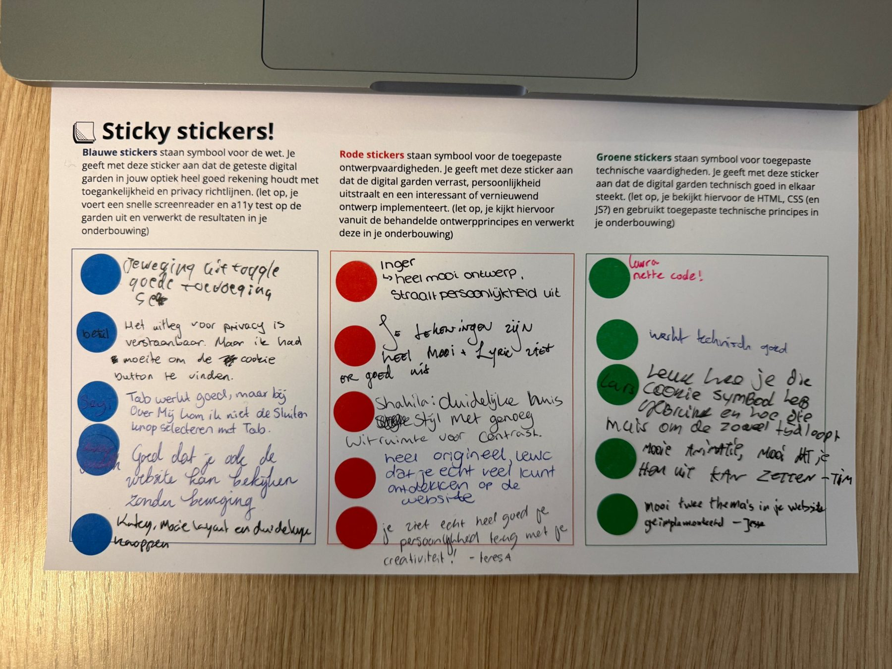

In de les hebben we met de hele klas een stickerronde gedaan. Je kon drie soorten stickers uitdelen: blauw voor privacy en toegankelijkheid, rood voor ontwerp en persoonlijkheid en groen voor technische vaardigheden. Ik heb vooral goede feedback gekregen. Er kwam vooral uit dat mijn website technisch goed werkt en dat hij veel persoonlijkheid uitstraalt. Dat was ook mijn focus bij het maken van mijn website. Als kleine feedback kreeg ik dat je bij Over mij niet met Tab bij de sluitknop kon komen.

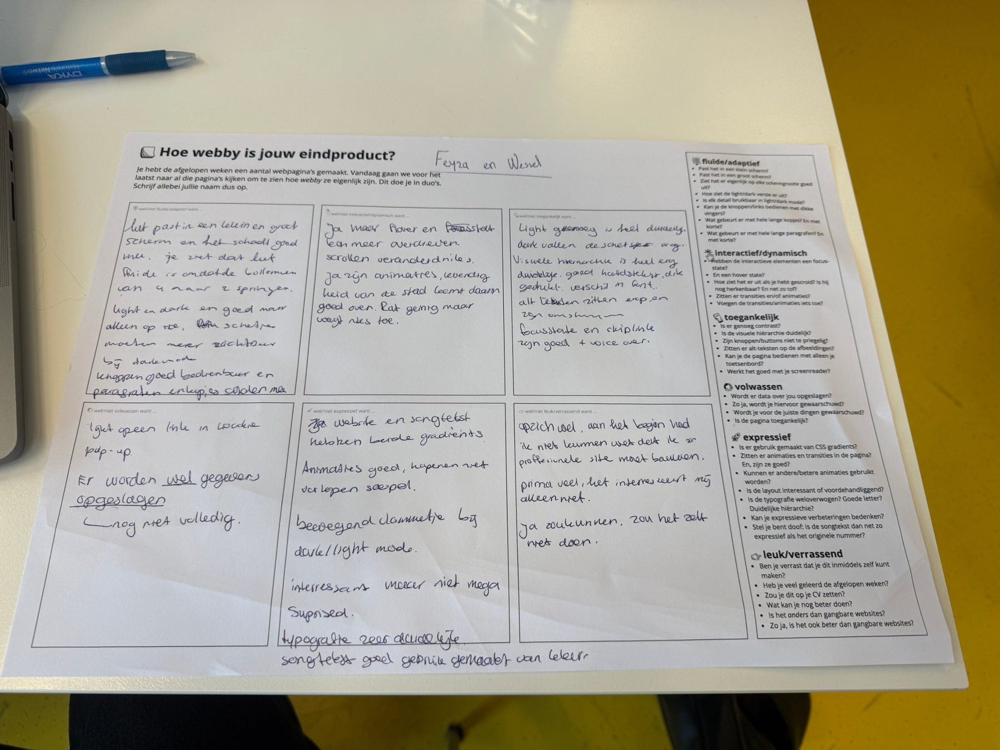

Met Feyza heb ik de Webby-check gedaan. We zijn eerst samen naar mijn product gaan kijken, aan de hand van de vragen op het blad. In principe voldeed ik aan alle vragen. Het enige punt waar ik feedback op kreeg, was de pop-up van de cookies. Daar stond een zinnetje in het blauw, en dat vonden ze verwarrend omdat het op een link leek. Die feedback heb ik meteen meegenomen. In plaats van blauw heb ik het zinnetje een normale zwarte kleur gegeven.

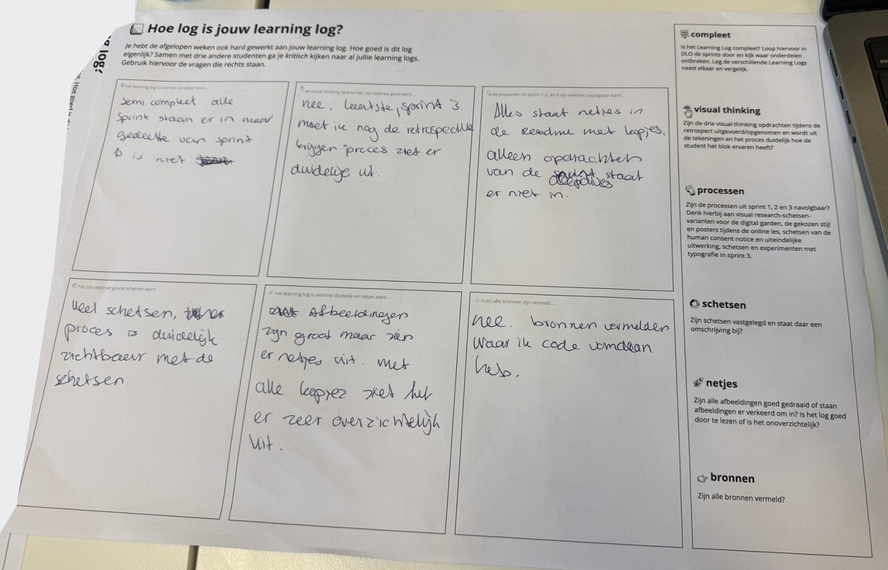

Bij de learning-logcheck hebben we in een groepje van vier naar elkaars learning logs gekeken. Mijn learning log is op zich redelijk compleet. De processen staan erin, er staan schetsen in en de bronnen heb ik erin gezet. Daarnaast heb ik een uitleg over hoe mijn website is opgebouwd. Daarom denk ik dat ik hier over het algemeen goed op scoorde.

## Proces van het maken van de site

Aanleiding

Na de laatste feedback op mijn woordentrap, mijn eerste website, besloot ik het helemaal anders aan te pakken. Ik had het niet gecodeerd zoals zij wilden. Ik had het gedaan op de manier die we vorig jaar hadden geleerd, maar dat is geen juiste manier, want zo is het niet goed leesbaar. Daarom ben ik een geheel nieuwe HTML en CSS gaan maken voor de homepagina.

Het idee

Eerst was het belangrijk om schetsen te maken van hoe ik wilde dat de homepagina eruit zou zien. Het is jouw digitale tuintje, dus het moest echt van jou zijn. Om het persoonlijk te maken, wilde ik iets doen met mijn paraaf, een soort logo dat ik zelf heb gemaakt. Dat kreeg ik ook als feedback. Die paraaf wilde ik centraal hebben, met daaromheen allemaal schetsen, zoals te zien is op mijn wireframes.

In mijn schetsboek heb ik verschillende versies uitgeprobeerd van hoe de homepagina eruit kon zien. Ik heb vooral gespeeld met mijn naam: soms Jan Wessel, soms Jan Wessel Cornelis, soms Wessel de Wit, en soms alleen mijn paraaf groot in het midden. In een paar schetsen stond er ook een foto met een stukje tekst bij, en in een andere versie had ik de trap als een soort digitaal tuintje met het menu ernaast. Wat ik bij al die versies het belangrijkste vond, is dat de site echt bij mij zou passen. Daarom wilde ik er zelfgemaakte schetsjes in stoppen. Zo voelt het niet als zomaar een website, maar als iets wat echt van mij is.

Om snel verschillende ideeën op papier te zetten, heb ik eerst kleine schetsjes gemaakt en er aantekeningen bij geschreven. Dat heb ik uit de deep dive Schetsen van Charley.

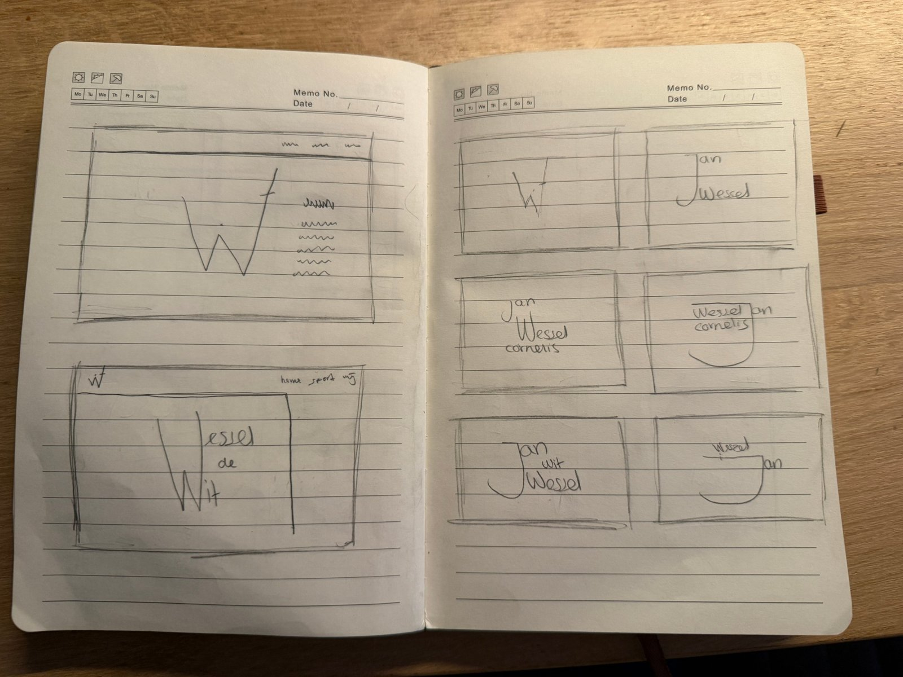

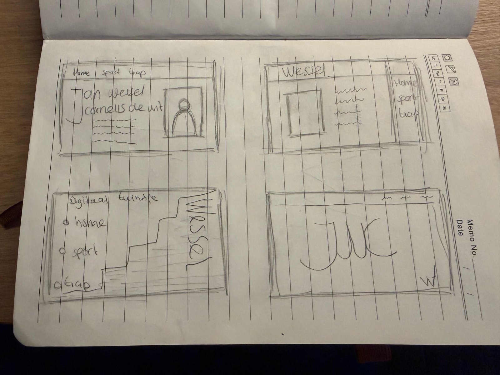

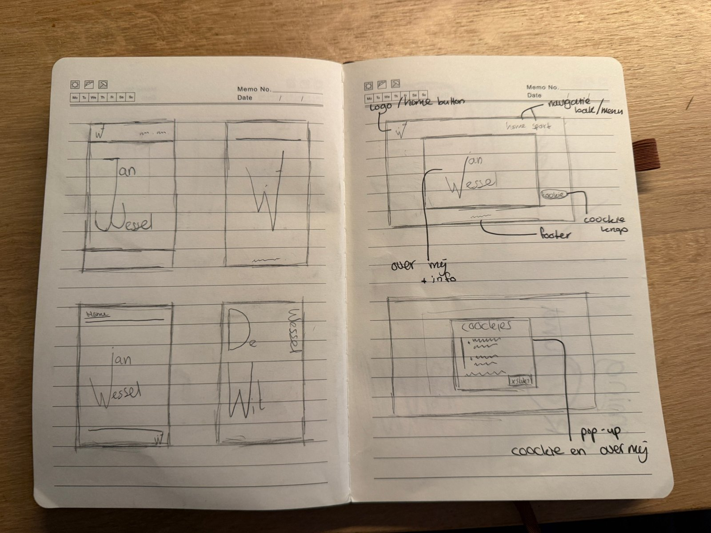

Mijn eerste idee was om kleine schetsjes te maken die bij mij pasten en die een beetje te laten bewegen, als leuke animatie. Ik wist eigenlijk al van tevoren dat dit niet goed te realiseren was, omdat mijn codeerskills niet mega waren. Dus ging ik denken aan oplossingen die meer in mijn straatje vallen.

Toen dacht ik: ik pak een van de schilderijen die ik heb gemaakt en gebruik dat als achtergrond van mijn website. Ik vond het wel belangrijk dat mijn naam centraal stond, of iets wat bij mijn naam paste, zoals mijn paraaf. Later kwam ik op het idee om mijn naam zelf te schrijven met mijn Wacom-tablet en die als middelpunt te gebruiken. Toen ik wist dat ik mijn schilderij als achtergrond ging gebruiken, samen met mijn naam en mijn paraaf, ben ik dat gaan coderen.

De opbouw van de pagina

Bij de woordentrap was alles verdeeld met divjes. Maar een divje kan een schermlezer niet lezen, dus dat moest veranderd worden. Nu heb ik alles opgebouwd zoals we in de sprint hebben geleerd en zoals ik uit de feedback heb gehaald: met een header, een main en een footer. Zo is de pagina wel goed leesbaar voor een schermlezer. Hoe je een pagina semantisch opbouwt, heb ik geleerd in de deep dive HTML & CSS Basics van Justus.

De body heb ik in een flexbox-kolom gezet. Met margin-top: auto blijft de footer daardoor altijd onderaan. De header en de footer heb ik even groot gemaakt, zodat het er mooi uitziet.

Aan de zijkanten wilde ik ruimte maken om mijn schetsjes te plaatsen. Dat heb ik in de main gedaan met clamp. Daarmee geef ik een minimum en een maximum aantal pixels aan. Op een laptop of groot scherm gaat het richting het maximum. Hoe groot je scherm is, bepaalt hoe dicht het daarbij komt. Wanneer je het scherm kleiner maakt, gaat het naar het minimum, zodat er altijd witruimte overblijft, bijvoorbeeld voor de lamp. Clamp en variabelen heb ik uit de deep dive Praktische CSS van Vasilis.

Het menu

In de header staat linksboven mijn paraaf. Rechts stond in eerste instantie de navigatie in woorden, maar daar heb ik later kleine icoontjes van gemaakt. De trap is wat ik in eerste instantie had gemaakt. Ik had daar veel tijd in gestopt, dus ik vond het zonde om die weg te doen. Op de sportpagina vertel ik over de sporten die ik doe. De galerij was het laatste wat ik heb bedacht. Om het nog persoonlijker te maken, heb ik naast de tekening van de Brouwersgracht nog een paar andere schilderijen gemaakt. Ik vond het leuk om daar ook wat over te vertellen, omdat het bij mij past.

Het menu heb ik gemaakt met een nav en vijf links. Het belangrijkste is dat ik er aria-current="page" bij heb gezet. Daardoor weet een schermlezer welke pagina actief is. In de CSS heb ik daar een streepje onder gezet, zodat je ook als gewone gebruiker ziet op welke pagina je bent. Aria-current en states zoals :hover en :focus-visible komen uit de deep dive Buttons, states en selectors van Vasilis.

Als je met je muis over een icoontje gaat, wordt het een klein beetje groter. Zo zie je dat je erop kunt klikken. Dat heet een micro-interactie. Dat heb ik uit de deep dive Interactie van Nicky.

De achtergrond

Ik wilde de tekening van de Brouwersgracht in zijn geheel op mijn website laten zien. Maar die is veel te lang, dus daar moest ik iets op bedenken.

De achtergrond staat alleen in de main. Met de margin en de flexbox zorg ik ervoor dat hij daar niet buiten komt. Met background-size: cover vult hij de hele main. Over de tekening heb ik een lichte waas gelegd met een linear-gradient. Daardoor blijft mijn naam goed leesbaar en wordt het niet te druk. Dat heb ik uit de deep dive Mooie kleuren en gradients van Sanne. Daardoor is hij niet helemaal zichtbaar, dus het moest een soort animatie worden, waarbij je automatisch door de tekening heen gaat zonder dat je zelf scrollt. Dat heb ik gedaan met een keyframe-animatie, wat ik heb geleerd in de deep dive CSS animaties van Sanne.

Dit gebeurt alleen op een groot scherm, omdat het daar in de breedte staat. Wanneer je het scherm kleiner maakt, zie je op je telefoon uiteindelijk wel de hele tekening.

De schetsjes en responsiveness

Het moest allemaal responsive zijn. Het was de bedoeling om mobile first te ontwerpen, maar ik heb het andersom aangepakt. Ik heb eerst de desktopversie gemaakt, omdat ik daar al mijn schetsjes en ideeën voor had getekend. Maar wanneer het scherm kleiner werd, zag het er heel druk en lelijk uit.

Alle schetsjes hebben position: fixed, zodat ze op een vaste plek op de website staan. Op een klein scherm wilde ik alleen de belangrijkste schetsjes laten zien, zoals de lamp voor de dark- en lightmode en de cookie voor de cookiepop-up. Op een groot scherm zie je ze allemaal. Dat heb ik gedaan door de andere schetsjes display: none te geven. Met een mediaquery worden ze vanaf een bepaalde schermgrootte display: block en dan zie je ze wel. Ik heb ze een eenheid in vw gegeven, zodat ze meegroeien met de grootte van het scherm. Position: fixed heb ik geleerd in de deep dive Position + Dialogs van Sanne, en de mediaquery's in Grid 101 + Media queries van Sanne.

De pop-ups: over mij en de cookie

Op mijn pagina zitten twee pop-ups. Je kunt op mijn naam klikken en op de cookie. Bij mijn naam krijg je onder “Over mij” een stukje over wie ik ben. Bij de cookie krijg je informatie over welke cookies je accepteert. Bij mij zijn dat er niet veel: het gaat om GitHub Pages, waar de site op draait, en de webring van de digitale tuintjes.

Beide pop-ups zijn een dialog. Met commandfor geef je aan welke dialog je gebruikt en met command="show-modal" zeg je dat de knop een modal opent. Zo kun je een pop-up maken zonder JavaScript. Ik heb daarvoor een button gebruikt, omdat je dan op dezelfde pagina blijft. Dat heb ik geleerd in de deep dives Buttons + Dialogs en Position + Dialogs van Sanne.

Light- en darkmode

Een van de opdrachten was om je website, bij mij alleen de homepagina, in een dark- en lightmode te maken. Dit werd ook uitgelegd in de deep dive Light & Dark theme van Vasilis.

In mijn lamp zit een checkbox. Daarmee kun je op de pagina zelf wisselen tussen licht en donker. De checkbox zelf is niet zichtbaar, omdat ik wilde dat het een tekening was in plaats van een normale checkbox. Ik heb twee tekeningen van de lamp gemaakt, eentje voor de darkmode en eentje voor de lightmode. Het label zorgt ervoor dat wanneer je op de tekening klikt, de checkbox ook aan- of uitgezet wordt. Een checkbox samen met :has() gebruiken heb ik uit de deep dive Meer interactie met HTML en CSS van Vasilis.

Bij de woordentrap had ik twee versies van mijn icoontjes gemaakt: een witte en een zwarte. Maar ik dacht: er moet vast een andere manier zijn. Zo kwam ik op het idee om filter: invert(1) te gebruiken. Wanneer je wisselt van licht naar donker, veranderen de zwarte icoontjes daardoor naar wit.

Alle kleuren die moeten wisselen, heb ik als variabelen in de CSS gezet. Wanneer de lamp het kleurenschema op donker zet, wisselen alle kleuren in één keer, overal waar ik die variabelen heb gebruikt. Ik hoef dus niet voor elk onderdeel aparte code te schrijven. Dat scheelt een stuk.

De lamp staat met position: fixed helemaal rechts in het scherm. Met clamp wordt hij groter en kleiner met het scherm mee. Het is een lamp, dus je moet ook zien dat het een lamp is. Bij hover zie je daarom dat het een knop is waar je op kunt klikken, en gaat de lamp een beetje aan door een gele gloed. In de darkmode is dat een blauwe gloed, voor een rookachtig effect, alsof de kaars in de lantaarn net is uitgegaan. Die gloed heb ik gemaakt met filter: drop-shadow. Dat heb ik uit de deep dive CSS: fonts met kleur en effecten van Sanne.

Het enige nadeel van deze manier is dat de modus niet meegaat met de dark- of lightmode-instelling van iemands computer of telefoon. Je kunt het alleen op de website zelf aanpassen. Ik wilde het wel in dezelfde stijl houden als de rest van mijn website, daarom heb ik voor deze keuze gekozen. Het overgrote deel heb ik uit de deep dives gehaald, maar ik wilde er wel mijn eigen swing aan geven.

De rat

Ik vond het leuk als de rat als een soort animatie door het scherm zou bewegen. Ik wist in eerste instantie niet hoe dat moest, dus ik heb het online opgezocht. Zo kwam ik bij keyframes. Daarmee vertel je wat er op welk moment gebeurt. Als je dat koppelt aan een animatie, bepaal je hoe lang en hoe vaak het duurt.

De rat begint helemaal linksonder en de hele animatie duurt 40 seconden. Ik wilde dat hij het grootste deel van de tijd stilstond, dan in een paar seconden over het scherm naar rechts liep en daarna even weg was. Daarvoor heb ik de percentages in de keyframes uitgerekend. Met linear gaat hij overal even snel, en met infinite blijft hij altijd doorgaan. Later kwam dit ook terug in de deep dive CSS animaties van Sanne.

Beweging uit

Volgens de regels voor toegankelijkheid moet je bewegende animaties ook kunnen stoppen. Daarom staat er in de footer een vinkje “beweging uit”. Met :has() kijkt de CSS of dat vinkje aanstaat. Zo ja, dan stoppen alle animaties op het hele scherm, dus ook de achtergrond en de rat.

De sportpagina

Op de sportpagina laat ik de vier sporten zien die ik wekelijks doe: hockey, hardlopen, gym en golf. Elke sport heeft een eigen kaart met een foto, een titel en een korte zin. Als je op een kaart klikt, ga je naar de pagina van die sport.

De kaarten staan in een lijst, omdat het eigenlijk een rijtje sporten is. Met grid staan ze op een telefoon onder elkaar en op een groot scherm twee naast elkaar. In de kaart zelf staat de foto links en de tekst rechts. Bij hover komt de kaart een stukje omhoog met een schaduw, zodat zichtbaar is dat je erop kunt klikken.

Op de pagina van elke sport staat de foto links over twee rijen en de terugknop onderaan over de hele breedte. Dat heb ik gedaan met grid-row en grid-column. Op een telefoon komt alles onder elkaar. Dat heb ik uit de deep dive Responsive grid van Vasilis.

Elke sport heeft een eigen kleur. Die heb ik uit de foto zelf gehaald, waardoor het goed matcht. Voor hockey wilde ik in eerste instantie de kleur gebruiken van het Terriërs-shirt, maar het felle geel in combinatie met witte letters kon ik niet gebruiken, omdat het bij de contrastcheck zeer laag scoorde. Daarom heb ik een donkerdere kleur geel gekozen en heb ik in plaats van een witte kleur voor de tekst een zwarte kleur gekozen. Hierdoor is het contrast beter en is het beter leesbaar voor mensen die kleurenblind of slechtziend zijn.

Testen

Om te kijken of mijn site echt voor iedereen werkt, heb ik hem getest. Mijn HTML heb ik door de W3C-validator gehaald. Daarnaast heb ik de site met alleen mijn toetsenbord en met VoiceOver gebruikt, en het contrast van mijn kleuren gecontroleerd. Wat daaruit kwam, staat in de foto's bij sprint 2.

Belangrijkste keuzes en waarom

Voor het font ben ik op zoek gegaan naar een duidelijk lettertype. Ik heb uiteindelijk drie fonts gekozen: Bebas Neue voor de titels, Oswald voor de gewone tekst en Space Grotesk voor de kleine teksten, zoals in de footer en de pop-ups. Dat je elk font een eigen rol geeft, heb ik uit de deep dive Typografie van Diederik.

Daarnaast heb ik mijn eigen logo gebruikt. Dat had ik al eerder gemaakt: ik gebruik het ook bij mijn portfolio en als handtekening onder mijn schilderijen. Ik vond het leuk om dat terug te laten komen op mijn digital garden.

AI-gebruik

Sparren en uitleg: ik heb Claude en Gemini gebruikt om mij te helpen met bepaalde ideeën te verwerkelijken. Wanneer ik een idee had stuurde ik het soms in de chat en die kwam dan met extra aanvulling wat mij weer verder liet denken.

Code: bij het coderen heb ik om extra uitleg gevraagd bij wat er in de deepdives werd besproken zodat het meer helder werd. Hierdoor kon ik het beter implementeren op mijn website. Gevraagd om tips hoe ik het beste bepaalde punten in mijn website kan aanspreken. Maar ik heb de code er altijd zelf ingetypt en gekeken en berekend wat de verhoudingen zijn.

Teksten/Afbeeldingen: bij een overgroot deel van mijn teksten heb ik Claude gebruikt om ze vloeiend leesbaar te maken zonder spelfouten of foutieve zinsstructuur. Ik heb een aantal schetsen die ik heb gemaakt als png laten maken zodat ik het kon gebruiken in mijn website doordat mijn Wacom-tablet het niet meer deed.

Controle: Claude heeft de onnodige code eruit gehaald en het netjes gemaakt.

Kleuren: Ik heb bij een aantal verschillende dingen, zoals bij mijn sportpagina en mijn songtekst, de kleuren uit de afbeelding zelf gebruikt. Bij de sportpagina heb ik bijvoorbeeld de kleur gebruikt die je op de achtergrond ziet bij de sportschool. Bij de songtekst heb ik de exacte kleuren gebruikt die je op de cover ziet. AI heeft me geholpen om die exacte kleurcodes uit die foto’s te halen.

Songtekst: Bij controle van de code heb ik na feedback van AI overal 'prefers-reduced-motion' erbij gezet voor mensen met een beperking. Daarnaast heb ik ermee gespard over wat voor animatie bij welk woord een leuk effect heeft wat past bij het nummer en bij de bewegende achtergrond.  

Ik heb alles wat erin staat zelf erin gezet en kan het uitleggen.

## Bronnen

### Deep dives (DLO)

Het grootste deel van mijn code komt uit de deep dives:
- HTML & CSS Basics van Justus: semantische opbouw
- Praktische CSS van Vasilis: clamp() en variabelen
- Buttons, states en selectors van Vasilis: aria-current, :hover, :focus-visible
- CSS animaties van Sanne: @keyframes en animation
- Position + Dialogs en Buttons + Dialogs van Sanne: schetsjes en pop-ups
- Grid 101 + Media queries van Sanne en Responsive grid van Vasilis: grid en responsive
- Light & Dark theme en Meer interactie met HTML en CSS van Vasilis: de lamp en beweging uit
- Variabele fonts van Sanne: Seraphs op de songtekstpagina. Dit font kreeg iedereen bij de oefening van het vak

### Digitale tuintjes van anderen

- Inspiratie uit de code van digitale tuintjes van andere studenten

### Youtube

- Kevin Powell, HTML & CSS for Absolute Beginners: Semantic HTML: https://www.youtube.com/watch?v=YOsMJQfwqow
- Kevin Powell, dialog = the easiest way to make a popup modal: https://www.youtube.com/watch?v=TAB_v6yBXIE

### Extra uitleg bij de lastige dingen

- filter: invert(1) voor de icoontjes in darkmode: https://www.w3schools.com/cssref/css3_pr_filter.php
- display: inline-block, zodat losse woorden kunnen draaien en bewegen: https://www.w3schools.com/css/css_inline-block.asp
- Bewegende achtergrond met background-size en background-position: https://www.w3schools.com/css/css3_gradients.asp
- font-variation-settings voor de vorm van Seraphs: https://developer.mozilla.org/en-US/docs/Web/CSS/font-variation-settings
- form method="dialog" en ::backdrop bij de pop-ups: https://developer.mozilla.org/en-US/docs/Web/HTML/Element/dialog
- commandfor en command="show-modal" om de pop-ups te openen zonder JavaScript: https://developer.mozilla.org/en-US/docs/Web/API/Invoker_Commands_API
- background-attachment: fixed voor de bewegende achtergrond op de songtekstpagina: https://developer.mozilla.org/en-US/docs/Web/CSS/background-attachment

### Testen

- W3C-validator: https://validator.w3.org/
- WebAIM contrastchecker: https://webaim.org/resources/contrastchecker/

### AI

- Claude
- Gemini
